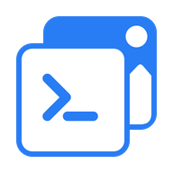

<p align="center">
  
</p>

<h1 align="center">quickthumb</h1>

<p align="center">
  <a href="README.md">English</a> · <a href="README.ko.md">한국어</a> · <a href="README.ja.md">日本語</a> · <a href="README.zh-CN.md">简体中文</a>
</p>

<p align="center">
  <strong>다음 썸네일도, 같은 레이아웃으로.</strong>
</p>

quickthumb은 **썸네일과 소셜 이미지를 꾸준히 발행하는 개발자를 위한 Python 라이브러리**입니다.
레이아웃을 코드로 만들어 두고 제목, 회차, 색상을 바꿔 다음 이미지를 만드세요.
Python 함수나 JSON 명세를 콘텐츠 파이프라인에 넣어 반복 제작할 수 있습니다.

<p align="center">
  <a href="https://quickthumb.solaqua.dev/ko/getting-started/">시작하기</a> · <a href="https://quickthumb.solaqua.dev/ko/cookbook/">예제 살펴보기</a> · <a href="https://quickthumb.solaqua.dev/ko/api/">API 레퍼런스</a>
</p>

## 첫 에피소드 카드 3장 만들기

하나의 레이아웃으로 **1280 × 720 에피소드 카드 3장**을 만듭니다.
기본 패키지와 내장 글꼴만 사용하므로, 설치 후에는 별도 에셋을 다운로드하지 않습니다.

| 12 | 13 | 14 |
| --- | --- | --- |
|  |  |  |

**Python 3.11 이상**이 필요합니다. quickthumb 저장소 밖의 작업 폴더에서 실행하세요.
가상 환경이 필요하다면 [설치 안내](https://quickthumb.solaqua.dev/ko/installation/)의 Bash/Zsh 및 Windows
설정 방법을 참고한 뒤 설치하세요:

```bash
python -m pip install quickthumb
```

아래 전체 예제를 `episode_cards.py`로 저장한 뒤 실행하세요:

```bash
python episode_cards.py
```

같은 폴더에 생성된 `episode-12.png`, `episode-13.png`, `episode-14.png`를 열어 보세요.
**실행할 때마다 이 세 파일을 덮어씁니다.**

내장 글꼴로 바로 실행해 볼 수 있도록 예제 제목은 영어로 두었습니다.

```python
from quickthumb import Canvas, Stroke

INK = "#111111"
WHITE = "#FFFFFF"


def episode_card(episode, title, accent):
    return (
        Canvas(1280, 720)
        .background(color=INK)
        .shape("rectangle", position=(0, 0), width=1280, height=360, color=accent)
        # 숫자를 띠 위에 놓고, 윗부분은 캔버스 밖으로 잘라 냅니다.
        .text(
            str(episode),
            size=540,
            color=INK,
            # 텍스트와 같은 색의 외곽선으로 내장 글꼴을 두껍게 만듭니다.
            effects=[Stroke(width=8, color=INK)],
            position=(1240, 360),
            align=("right", "bottom"),
            letter_spacing=-10,
        )
        .text(
            "THE BUILDER'S\nNOTEBOOK",
            size=26,
            color=INK,
            effects=[Stroke(width=1, color=INK)],
            position=(48, 44),
            letter_spacing=1,
        )
        .text(
            "EPISODE",
            size=26,
            color=INK,
            effects=[Stroke(width=1, color=INK)],
            position=(48, 330),
            align=("left", "bottom"),
            letter_spacing=1,
        )
        .text(
            title,
            size=136,
            color=WHITE,
            effects=[Stroke(width=2, color=WHITE)],
            position=(48, 688),
            align=("left", "bottom"),
            max_width=1184,
            max_height=290,
            auto_scale=True,
            balance_lines=True,
            line_height=1.04,
        )
    )


episodes = [
    (12, "Ship your first release", "#FF4B1F"),
    (13, "Make room for better work", "#FFD400"),
    (14, "Build less. Finish more.", "#4D8DFF"),
]

for episode, title, accent in episodes:
    episode_card(episode, title, accent).render(f"episode-{episode}.png")
```

`episodes`에서 제목이나 강조색을
바꾸고 다시 실행해 보세요. 레이아웃을 그대로 두고 내용만 바꾼 카드를 얻을 수 있습니다.
여러 장을 일괄 제작하기 전에는 가장 긴 제목도 확인하세요.

한국어 등 다른 언어를 넣으려면 해당 문자를 지원하는 로컬 글꼴을 지정하세요.
[텍스트 안내](https://quickthumb.solaqua.dev/ko/api/text/)에서 설정 방법을,
[첫 카드 만들기](https://quickthumb.solaqua.dev/ko/getting-started/)에서 레이아웃 수정 방법을 볼 수 있습니다.

## 레이아웃은 그대로, 내용은 새롭게

- **내용과 레이아웃을 분리하세요.** Python 함수를 재사용하거나 파이프라인에서
  [JSON 명세](https://quickthumb.solaqua.dev/ko/json-schema/)를 불러올 수 있습니다.
- **달라지는 제목 길이에 대비하세요.** 줄바꿈과 크기 조절 범위를 지정하거나
  [자동 레이아웃 그룹](https://quickthumb.solaqua.dev/ko/api/group/)으로 행과 열을 배치하세요.
- **내보내기 전에 확인하세요.** `diagnose()`는 캔버스 밖의 레이어, 작은 글자,
  낮은 대비 같은 문제를 알려 줍니다. 디자인의 완성도를 판단하지는 않습니다.
  [진단의 범위와 한계](https://quickthumb.solaqua.dev/ko/diagnostics/)를 확인하세요.

렌더링 결과를 재현하려면 에셋, 글꼴, 렌더링 환경을 함께 유지해야 합니다.
실행 시점이나 기기가 달라도 같은 픽셀을 기대한다면
[재현성 조건](https://quickthumb.solaqua.dev/ko/reference/export-assets/#render-reproducibility)을 먼저 확인하세요.

## 완성된 디자인에서 시작하기


| YouTube 썸네일 | 해설 영상 썸네일 | 팟캐스트 에피소드 |
| --- | --- | --- |
| [](https://quickthumb.solaqua.dev/ko/cookbook/youtube-thumbnail/) | [](https://quickthumb.solaqua.dev/ko/cookbook/youtube-thumbnail/#reaction) | [](https://quickthumb.solaqua.dev/ko/cookbook/podcast-promo/) |

[레이아웃과 소스 코드 살펴보기 →](https://quickthumb.solaqua.dev/ko/cookbook/)

## 다른 형식으로도 내보내려면

기본 패키지는 PNG, JPEG, WebP, SVG, HTML, GIF를 내보냅니다. PDF와 PPTX에는
선택 패키지가, MP4와 WebM에는 FFmpeg가 필요합니다. 형식마다 지원 범위와
표현 결과가 다르므로 [설치](https://quickthumb.solaqua.dev/ko/installation/)와 [내보내기](https://quickthumb.solaqua.dev/ko/exports/)를 확인하세요.

여러 슬라이드로 된 프레젠테이션이나 내레이션 영상은
[Deck 안내](https://quickthumb.solaqua.dev/ko/api/deck/)를, 생성된 JSON 명세를 활용하는 방법은
[JSON과 AI 작업 흐름](https://quickthumb.solaqua.dev/ko/json-schema/)을 참고하세요.

## 라이선스

[MIT](LICENSE)
