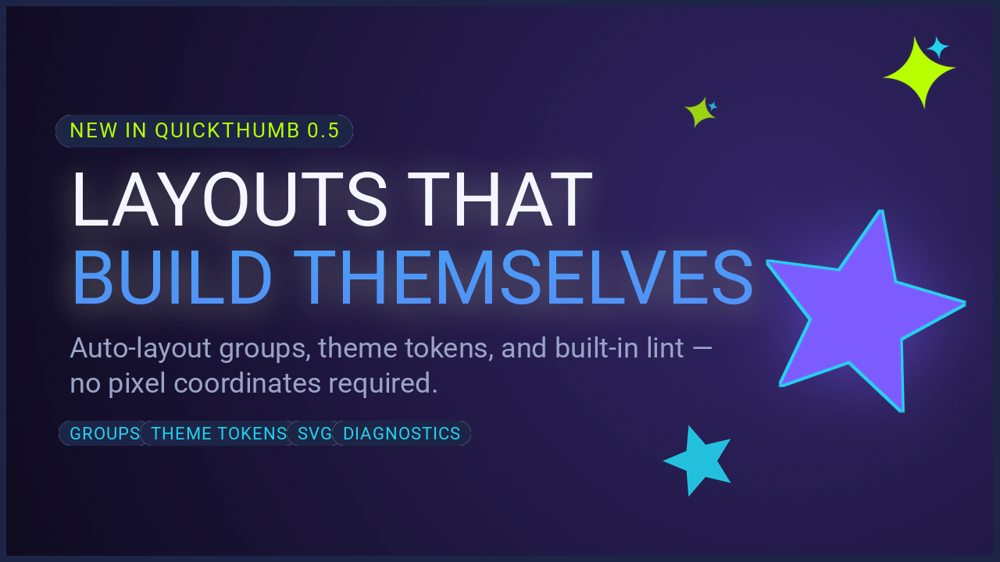
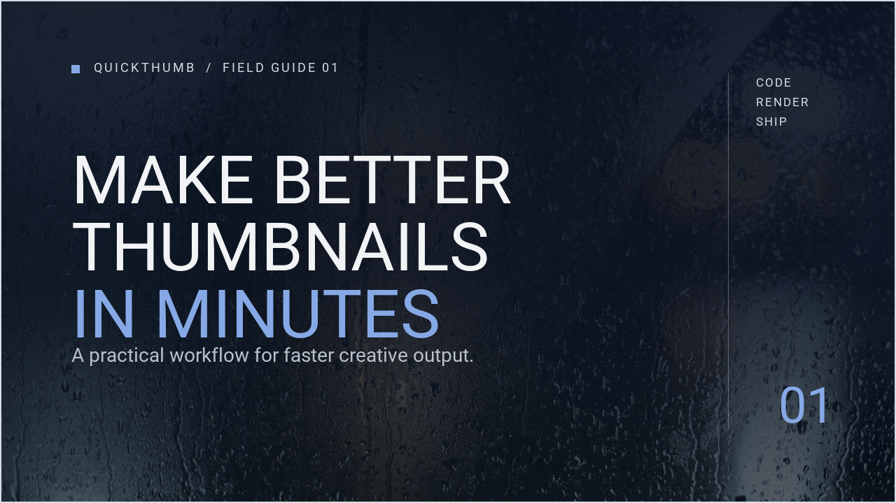

<p align="center">
  
</p>

<h1 align="center">quickthumb</h1>

<p align="center">
  <strong>Thumbnails and social images, from Python or JSON.</strong>
  <br />
  Build a layout once. Update the content for your next post.
</p>

<p align="center">
  <a href="https://quickthumb.solaqua.dev/getting-started/">Get started</a>
  ·
  <a href="https://quickthumb.solaqua.dev/cookbook/">Browse recipes</a>
  ·
  <a href="https://quickthumb.solaqua.dev/api/">API reference</a>
</p>

Define a layout once, then update the headline, episode, or accent color for each
new image. Use quickthumb in Python scripts and content pipelines that need
recurring thumbnails, episode cards, or social graphics.



| YouTube thumbnail | Commentary thumbnail | Podcast episode |
| --- | --- | --- |
| [](https://quickthumb.solaqua.dev/cookbook/youtube-thumbnail/) | [](https://quickthumb.solaqua.dev/cookbook/youtube-thumbnail/#reaction) | [](https://quickthumb.solaqua.dev/cookbook/podcast-promo/) |

[Explore these layouts and their source →](https://quickthumb.solaqua.dev/cookbook/)

## Quick start

Requires **Python 3.11+**. In your Python environment:

```bash
python -m pip install quickthumb
```

Save this as `episode_cards.py`. It uses the built-in font and needs no downloads
after installation:

```python
from quickthumb import Canvas, Stroke

INK = "#111111"
WHITE = "#FFFFFF"


def episode_card(episode, title, accent):
    return (
        Canvas(1280, 720)
        .background(color=INK)
        .shape("rectangle", position=(0, 0), width=1280, height=360, color=accent)
        # The numeral stands on the band and crops at the top edge.
        .text(
            str(episode),
            size=540,
            color=INK,
            # A stroke in the text color thickens the regular-weight built-in font.
            effects=[Stroke(width=8, color=INK)],
            position=(1240, 360),
            align=("right", "bottom"),
            letter_spacing=-10,
        )
        .text(
            "THE BUILDER'S\nNOTEBOOK",
            size=26,
            color=INK,
            effects=[Stroke(width=1, color=INK)],
            position=(48, 44),
            letter_spacing=1,
        )
        .text(
            "EPISODE",
            size=26,
            color=INK,
            effects=[Stroke(width=1, color=INK)],
            position=(48, 330),
            align=("left", "bottom"),
            letter_spacing=1,
        )
        .text(
            title,
            size=136,
            color=WHITE,
            effects=[Stroke(width=2, color=WHITE)],
            position=(48, 688),
            align=("left", "bottom"),
            max_width=1184,
            max_height=290,
            auto_scale=True,
            balance_lines=True,
            line_height=1.04,
        )
    )


episodes = [
    (12, "Ship your first release", "#FF4B1F"),
    (13, "Make room for better work", "#FFD400"),
    (14, "Build less. Finish more.", "#4D8DFF"),
]

for episode, title, accent in episodes:
    episode_card(episode, title, accent).render(f"episode-{episode}.png")
```

Run `python episode_cards.py`, then open `episode-12.png`, `episode-13.png`, and
`episode-14.png` in the same directory. Each is 1280 × 720 pixels.
Change a title in `episodes` and run it again to replace the corresponding card.

[Follow the first-use guide →](https://quickthumb.solaqua.dev/getting-started/)
for environment setup and ways to adapt the layout.

## Build a layout you can reuse

- **Keep content separate from layout.** Pass data into a Python function, or
  load a [JSON spec](https://quickthumb.solaqua.dev/json-schema/) from your pipeline.
- **Make room for changing text.** Set wrapping and fitting bounds, or use
  [auto-layout groups](https://quickthumb.solaqua.dev/api/group/) for rows and columns.
- **Catch common layout problems.** `diagnose()` flags issues such as off-canvas
  layers, small text, and low contrast before export.

Rendering can be repeated with fixed assets, fonts, and rendering environment.
See [reproducibility requirements](https://quickthumb.solaqua.dev/exports/#render-reproducibility)
when matching pixels across runs or machines.

## Export and extend

The base package exports PNG, JPEG, WebP, SVG, HTML, and GIF. PDF and PPTX need
optional packages; MP4 and WebM need FFmpeg. Format support and visual behavior
vary: see [Installation](https://quickthumb.solaqua.dev/installation/) and
[Exporting](https://quickthumb.solaqua.dev/exports/).

For multi-slide presentations and narrated video, see the
[Deck guide](https://quickthumb.solaqua.dev/api/deck/).
For generated JSON specs, see the
[JSON & AI workflow](https://quickthumb.solaqua.dev/json-schema/).

## License

[MIT](LICENSE)
