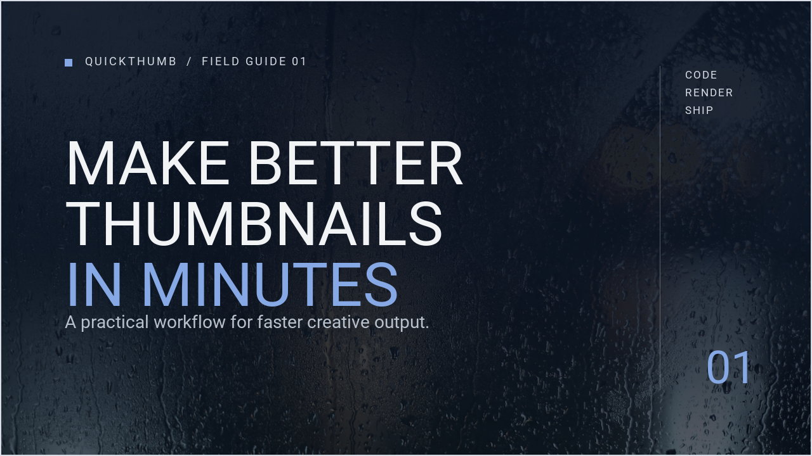
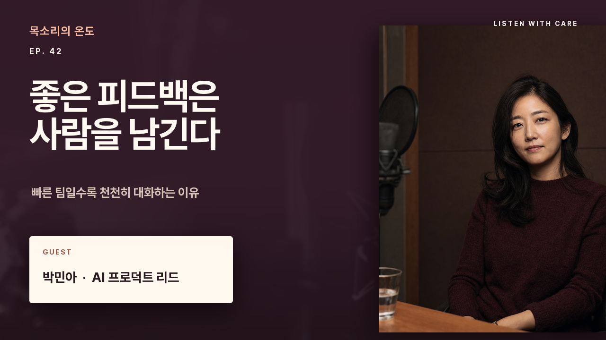

<p align="center">
  
</p>

<h1 align="center">quickthumb</h1>

<p align="center">
  <a href="README.md">English</a> · <a href="README.ko.md">한국어</a> · <a href="README.ja.md">日本語</a> · <a href="README.zh-CN.md">简体中文</a>
</p>

<p align="center">
  <strong>下一张缩略图，沿用这套布局。</strong>
</p>

quickthumb 是一个 **Python 库，适合需要持续制作缩略图和社交媒体配图的开发者**。
把布局写成代码，再传入新的标题、期数或颜色，就能生成下一张图片。
你可以将 Python 函数或 JSON 规格接入内容生产流程。

<p align="center">
  <a href="https://quickthumb.solaqua.dev/zh/getting-started/">开始使用</a> · <a href="https://quickthumb.solaqua.dev/zh/cookbook/">浏览示例</a> · <a href="https://quickthumb.solaqua.dev/zh/api/">API 参考</a>
</p>

## 先生成三张节目卡片

这个示例用同一套布局生成三张 **1280 × 720 的节目卡片**。
只需基础包和内置字体，安装后无需再下载素材。

| 12 | 13 | 14 |
| --- | --- | --- |
|  |  |  |

需要 **Python 3.11 或更高版本**。请在 quickthumb 源码目录之外的工作文件夹中运行。
如需创建虚拟环境，请先查看[安装指南](https://quickthumb.solaqua.dev/zh/installation/)中的 Bash/Zsh 和 Windows
设置步骤，然后安装：

```bash
python -m pip install quickthumb
```

将下方完整示例保存为 `episode_cards.py`，然后运行：

```bash
python episode_cards.py
```

打开同一文件夹中的 `episode-12.png`、`episode-13.png` 和 `episode-14.png`。
**每次运行都会覆盖这三个文件。**

示例标题保留英文，方便你直接使用内置字体试跑。

```python
from quickthumb import Canvas, Stroke

INK = "#111111"
WHITE = "#FFFFFF"


def episode_card(episode, title, accent):
    return (
        Canvas(1280, 720)
        .background(color=INK)
        .shape("rectangle", position=(0, 0), width=1280, height=360, color=accent)
        # 将数字放在色带上，让顶部超出画布并被裁切。
        .text(
            str(episode),
            size=540,
            color=INK,
            # 用与文字相同颜色的描边加粗内置字体。
            effects=[Stroke(width=8, color=INK)],
            position=(1240, 360),
            align=("right", "bottom"),
            letter_spacing=-10,
        )
        .text(
            "THE BUILDER'S\nNOTEBOOK",
            size=26,
            color=INK,
            effects=[Stroke(width=1, color=INK)],
            position=(48, 44),
            letter_spacing=1,
        )
        .text(
            "EPISODE",
            size=26,
            color=INK,
            effects=[Stroke(width=1, color=INK)],
            position=(48, 330),
            align=("left", "bottom"),
            letter_spacing=1,
        )
        .text(
            title,
            size=136,
            color=WHITE,
            effects=[Stroke(width=2, color=WHITE)],
            position=(48, 688),
            align=("left", "bottom"),
            max_width=1184,
            max_height=290,
            auto_scale=True,
            balance_lines=True,
            line_height=1.04,
        )
    )


episodes = [
    (12, "Ship your first release", "#FF4B1F"),
    (13, "Make room for better work", "#FFD400"),
    (14, "Build less. Finish more.", "#4D8DFF"),
]

for episode, title, accent in episodes:
    episode_card(episode, title, accent).render(f"episode-{episode}.png")
```

修改 `episodes` 中的标题或强调色后再次运行，
就能看到沿用同一布局的新卡片。批量生成前，请先用最长的实际标题检查效果。

要使用中文等其他语言，请指定包含所需字符的本地字体。设置方法见[文本](https://quickthumb.solaqua.dev/zh/api/text/)，
布局修改方法见[制作第一组卡片](https://quickthumb.solaqua.dev/zh/getting-started/)。

## 保留布局，更新内容

- **将内容与布局分开。** 复用 Python 函数，或在流程中加载
  [JSON 规格](https://quickthumb.solaqua.dev/zh/json-schema/)。
- **适应不同长度的标题。** 设置换行和字号调整范围，或使用
  [自动布局编组](https://quickthumb.solaqua.dev/zh/api/group/)按行或列排列。
- **导出前检查。** `diagnose()` 会提示画布外的图层、过小的文字、对比度不足等常见问题。
  它不判断设计是否美观；详见[诊断范围与局限](https://quickthumb.solaqua.dev/zh/diagnostics/)。

要复现渲染结果，需要保留素材、字体和渲染环境。若希望在不同时间或机器上得到相同像素，
请先查看[可复现性要求](https://quickthumb.solaqua.dev/zh/reference/export-assets/#render-reproducibility)。

## 从现成设计开始


| YouTube 缩略图 | 评论类视频缩略图 | 播客节目 |
| --- | --- | --- |
| [](https://quickthumb.solaqua.dev/zh/cookbook/youtube-thumbnail/) | [](https://quickthumb.solaqua.dev/zh/cookbook/youtube-thumbnail/#reaction) | [](https://quickthumb.solaqua.dev/zh/cookbook/podcast-promo/) |

[查看布局及其源代码 →](https://quickthumb.solaqua.dev/zh/cookbook/)

## 需要其他输出格式？

基础包支持导出 PNG、JPEG、WebP、SVG、HTML 和 GIF。PDF 和 PPTX 需要安装可选依赖，
MP4 和 WebM 需要 FFmpeg。各格式的支持范围和视觉表现有所不同，
请查看[安装指南](https://quickthumb.solaqua.dev/zh/installation/)和[导出说明](https://quickthumb.solaqua.dev/zh/exports/)。

制作多页演示文稿或带旁白的视频，请参阅 [Deck 指南](https://quickthumb.solaqua.dev/zh/api/deck/)；
使用生成的 JSON 规格，请参阅 [JSON 与 AI 工作流](https://quickthumb.solaqua.dev/zh/json-schema/)。

## 许可证

[MIT](LICENSE)
