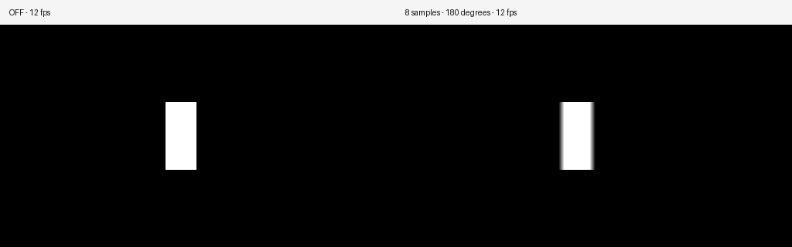
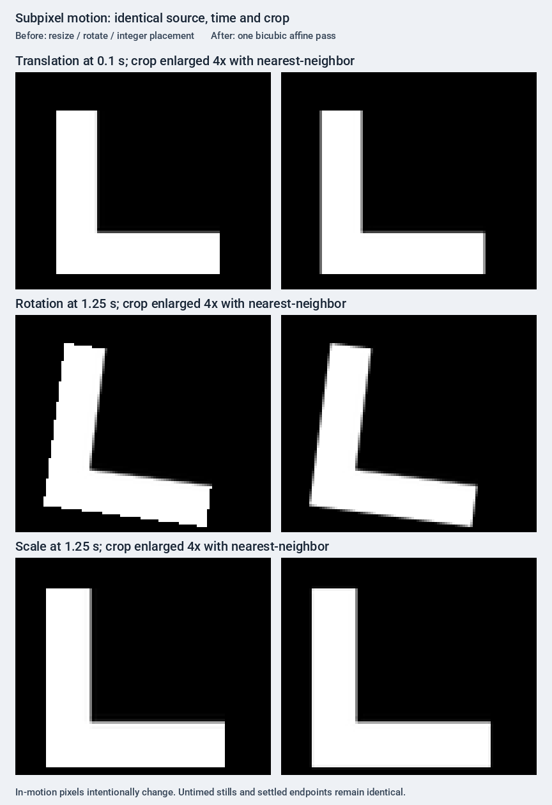
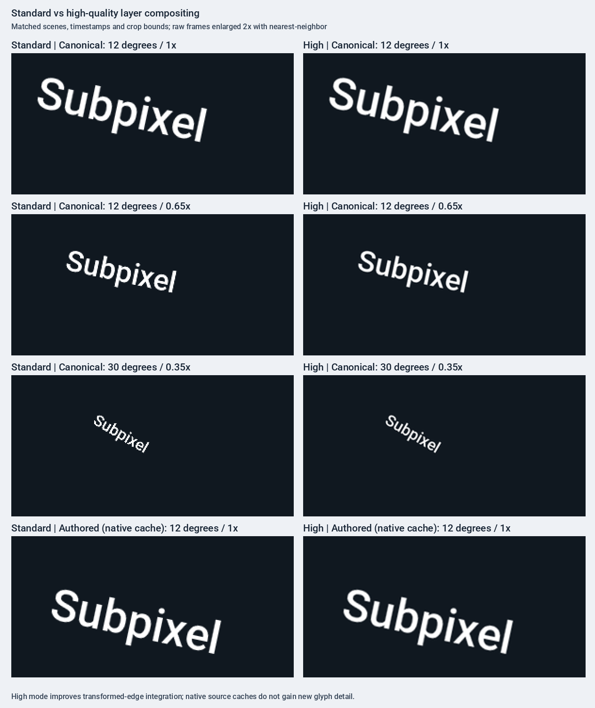

# Animated export benchmarks

## Temporal exposure cost

```bash
uv run --locked python -m benchmarks.animated_export --blur-cost \
  --formats mp4 --fps 12 --quality standard --json /tmp/motion-blur-cost.json
```

This explicit #146 workload uses `examples/motion_blur.py`: the same 512×288,
two-second marker travels 340 pixels on black. Only exposure changes: OFF,
2, 4 and 8 samples at a fixed 180° shutter; workers remain 1. It uses the
existing instrumented export timer, including consumed lazy render work and
final writes. Actual source-frame calls are recorded alongside encoder inputs.
Render/encoder wall-time decomposition remains a profile, not independent CPU
time or an uninstrumented speed claim.

One fresh-process warmup per condition precedes **five rotated rounds**. Warmups
are retained separately. Processes start with cold local caches; filesystem
caches are not flushed. Run without concurrent tests/heavy workloads. Every
measured output is decoded after timing/RSS collection to verify dimensions,
frame count and duration against its export receipt and the fixed workload.
Decoded RGB hashes must match across repetitions of each condition, and the
document hash must match across all conditions. Different sample counts
intentionally produce different pixels: this records quality cost, not a
speedup between equivalent renders.

JSON retains all runs, options, environment, hashes, medians and observed ranges.
Python RSS is each fresh process's lifetime peak before output decoding; it
includes imports/native Pillow and excludes FFmpeg. It does not prove a memory
upper bound or constant total memory. Increasing samples retains a bounded
accumulator and one current frame rather than every temporal sample; use the
recorded RSS as a workload observation. No process-tree measurement is claimed
on macOS.



The comparison decodes the frame at one second from the example's actual OFF
and 8-sample GIFs. Labels are added outside the frames; the pixels are unscaled.

Recorded on 2026-10-26 with 12 fps MP4, standard quality and workers=1:

| Samples | Total seconds, median [min–max] | Profiled render seconds, median | Source-frame calls | Parent RSS MiB, median [min–max] |
| --- | --- | --- | --- | --- |
| OFF | 0.0882 [0.0875–0.0889] | 0.0142 | 26 | 74.33 [74.02–75.64] |
| 2 | 0.1590 [0.1564–0.1621] | 0.0842 | 48 | 77.80 [77.72–86.20] |
| 4 | 0.2059 [0.2052–0.2099] | 0.1306 | 96 | 83.48 [78.44–85.62] |
| 8 | 0.3008 [0.2980–0.3209] | 0.2259 | 192 | 85.88 [83.70–86.80] |

All conditions decoded to 24 frames/2 seconds at 512×288. Actual frame-call
counts include preparation/settled observations, not just shutter samples.
More samples cost additional rendering; this is not an equal-output speed
comparison. Cooperating task agents paused heavy checks during measurement;
unrelated host activity was not controlled. See the [raw report](results/2026-10-26-166.json)
for all 20 measured runs, four warmups, hashes, exact options and environment.

## General export profile

Run from the repository root after the locked setup in `CONTRIBUTING.md`:

```bash
uv run --locked python -m benchmarks.animated_export --json /tmp/baseline.json
```

The command prints one table, including CPU, Python, Pillow, FreeType, text
layout, FFmpeg, platform, and source commit. Numeric metrics are medians
of **three fresh subprocesses**, with the total-time minimum–maximum range
reported alongside the median. Linux and macOS are supported; the memory
measurement uses `resource.getrusage`. FFmpeg and ffprobe must be available for
MP4/WebM. A failed export fails the command rather than becoming a skipped row.
No extra Python dependencies are needed.

## Fixed workload and measurement boundaries

- The complete eight-scene `examples/product_hype_reel.py` composition is used
  at its original 1080×1920 size, with its checked-in fonts and narration
- Three 256×192 synthetic scenes slowly translate, rotate, and scale an
  asymmetric white marker on black over two seconds
- The default export rate is 12 fps. GIF uses the example's bounded 432×768
  maximum size and 64 colors; MP4/WebM retain the original canvas dimensions
  and narration. No extra soundtrack is added
- Each run measures the public `Deck.render(..., animation=...)` path, including
  document construction, preflight, rendering, and final output writes
- `Render ms/input` amortizes all work outside the encoder over consumed
  encoder input items. GIF inputs are generated image/duration shots; video
  inputs are nonempty frame allocations after cumulative rounding. A generated
  sub-frame shot assigned zero playback frames is absent from the video count,
  while a static hold with many playback frames still counts once. The JSON
  keys `shots` and `render_ms_per_shot` retain their historical names. Before
  the prepared-animation/worker change, video counted all generated shots:
  those per-item metrics are not comparable when rounding drops an input
- `Encode s` is wall time inside the existing GIF/video encoder, **minus time
  spent pulling its lazy shot iterator**. It includes quantization, resizing,
  PNG intermediates, FFmpeg and audio encoding/muxing as applicable. These
  developer-only wrappers do not replace rendering or encoding algorithms
- `Python RSS MiB` is the isolated Python process's lifetime peak resident
  memory, including native Pillow allocations and imports. It excludes child
  FFmpeg processes. It is not total machine memory or a Python allocation-only
  trace, and the three-run median is not the worst observed peak
- `Font loads` counts successful native FreeType `getfont` calls; failed family
  probes are excluded. `Font s` includes time in successful and failed calls
- The JSON file retains every raw run, its fps/options and output SHA-256, as
  well as medians and the total-time range. Hashing runs after the timer and
  RSS sample. A nonempty file and matching shot count do not establish correct
  encoded frames, duration or audio: use the identity and codec regression
  gates as well. WebM metadata can vary, so its container hash is diagnostic
- Medians for different columns may come from different runs; do not add
  medians to derive another median

Use `--scenes translation rotation scale` or `--formats gif` for development
smoke runs. `--fps` selects another rate explicitly. Compare only matching
scene/format/options and environments; partial or lower-rate runs are not the
full baseline. Run timings without concurrent tests or other heavy workloads.
Fresh processes reset process-local font caches, but filesystem caches are not
flushed. Results are local measurements, not universal performance guarantees.

This command is an **instrumented export profile**: font calls and lazy-iterator
pulls are timed inside the overall measurement. Use it to locate likely costs,
then separately time the same public construction/export without these wrappers
to support an end-to-end speed claim. FFmpeg can overlap lazy rendering, so
subtracting iterator time does not measure independent encoder CPU work.

For before/after comparisons, interleave at least three fresh runs per revision
(for example, before/after, after/before, before/after), keeping scenes, options,
dependencies, cache policy and concurrency comparable. Report seconds with the
median and observed range; do not infer a speedup from medians alone. Verify
equivalent correct output/work, and retain failures rather than dropping or
retrying them into successful samples. Classify the result as faster, slower,
no measurable difference, or inconclusive; use inconclusive when correctness,
tuning or measurement validity prevents a fair comparison.

## Jitter metric

A separate fixed **30 fps** public `Deck.sample()` capture tracks the
intensity-weighted centroid of the white marker. The metric is the population
standard deviation of consecutive Euclidean centroid displacements, in pixels
per frame. Translation at 0.2 pixels/frame exposes the current 0/1-pixel
staircase. The off-centre centroid also moves under rotation/scale, avoiding a
misleading zero from a symmetric marker. The product reel has no isolated
marker, so its jitter cell is `n/a`.

The probe is run three times in separate processes before export measurements,
so it cannot warm the export's caches or inflate its RSS. This is a diagnostic
metric, not a complete perceptual quality score or a fixed acceptance threshold.
Rotation/scale rasterization and centroid measurement can contribute variation.

## Lossless frame-identity gate

Capture before and after a change in the same environment:

```bash
uv run --locked python -m benchmarks.frame_identity capture /tmp/before.json
# Apply the candidate change, without changing benchmark scenes or dependencies.
uv run --locked python -m benchmarks.frame_identity capture /tmp/after.json
uv run --locked python -m benchmarks.frame_identity compare /tmp/before.json /tmp/after.json
```

The default capture checks **every 12 fps canonical timeline sample**, the exact
final instant, and each settled slide from the public `Deck.sample()` API.
Full-resolution reel frames are captured in bounded batches; manifests contain
only digests and metadata, never base64 pixels. This costs extra timeline setup
work and is not used for performance measurements.

Comparison exits nonzero for any changed digest, missing frame, changed sample
instant, dimensions, slide, timeline, document specification, selection, rate,
or rendering environment. Source commit and CPU may differ. Paths under the
checkout root are normalized so equivalent worktrees can be compared. Identical
SHA-256 digests mean identical canonical raw RGBA bytes at the sampled instants.
The script does not certify unsampled instants, encoder container bytes, audio,
or codec fidelity; those require their existing export tests. Use `--fps 30`
(or another matching rate) to strengthen a particular lossless change's gate.

Baseline results and subsequent speedups belong in the discussion for
[performance issue #144](https://github.com/sjquant/quickthumb/issues/144).

## Loaded-font reuse (#148)

The font optimization reuses up to 128 resolved faces across canvases in a
process. Size, normalized variation settings and weight are part of the cache
key; file identity and modification metadata distinguish replaced fonts. Remote
font resolution still checks the document's asset policy before consulting the
loaded-face cache. Existing canvases keep their existing per-canvas reuse
semantics; a file change is observed when a new font resolution is performed.

Shared faces serialize mask rendering and metrics, including color-font
foreground-palette changes. Variable axes are configured before sharing a face.
Fallback resolution, warnings, cloning and export compatibility are covered by
regressions. No public cache-control API or new dependency is introduced.

Fresh-process benchmark runs deliberately measure cold process caches. Repeated
exports in a long-lived process can reuse more faces, but those warm timings are
not interchangeable with the baseline. See the results discussion in #144 for
same-workload font-load counts, byte-identity checks and measured timing changes.

## Raw video streaming (#150)

MP4/WebM send RGB24 frames directly to FFmpeg, allocating repeats on the same
cumulative half-up clock. Each shot is converted to bytes once and written for
its allocated frame count. Batches still contain at most 64 distinct emitted
shots, and the encoded segments use the existing audio mux. There is no PNG
image spool, and shot generation remains lazy. Stderr is drained concurrently
into a bounded diagnostic tail; failed producers and encoders are reaped.

Decoded-byte comparisons against the former PNG/concat path pass at 10 and
25 fps. The former path was not an exact-count reference at all rates: PNG
input used a 25 Hz time base, and its half-frame end trim could remove a counted
frame. A 129-frame numbered sequence spanning three batches lost two frames
at 12, 24, 29.97, 30, 60 and 120 fps in the old encoder. Streaming preserves all
129 frames in order. Tests check decoded frame identity/order, ffprobe counts,
durations and even-dimension cropping. Container bytes are not an identity
gate, and this timing correction intentionally differs from the old output.
Audio scheduling, codecs, and the 504-observation canonical RGBA gate remain
unchanged.

Long static holds trade the old compressed-image reuse for repeated raw pipe
writes. Benchmark those separately from the animated reel before generalizing
any encode-stage timing difference. The existing timer excludes lazy rendering;
FFmpeg may now perform some encoding concurrently with that rendering, so total
wall time is also important when comparing results.

## Static slide-prefix plate (#149)

Each slide pre-composites the leading static units once, in their original
order, onto a transparent RGBA plate. Frames start from a copy of that plate.
Static units above or between animated units remain in the per-frame stack;
regrouping translucent units there would change layer order or alpha rounding.
The internal frame compositor accepts an ordered unit sequence and an optional
prepared background, and returns a caller-owned full-canvas RGBA image.

Legacy effects, canonical and staggered timelines, animated components and
backdrop-dependent motion all stop the cached prefix. Video descendants stop
it even in reduced-motion mode, since foreground captions still sample time.
The optimization adds no public API or dependency.

`tests/test_static_slide_prefix.py` compares exact bytes against the uncached
ordered stack, including non-monotonic samples and returned-frame mutation.
It also counts `PIL.Image.alpha_composite` calls, including plate preparation:
for five samples of five units with a two-unit static prefix, calls fall from
25 to 17. An all-static three-unit stack falls from 15 to 3; a stack starting
with motion has the same call count. The complete workload's count and clean
median-of-three export timings belong in the #144 results discussion. Timing
and RSS must include slide preparation and the retained full-size plates.

## Incremental GIF encoding (#153)

GIF quantization and drift-free centisecond allocation are unchanged. A bounded
Pillow adapter retains the previous normalized image and one pending encoded
frame; identical images extend the pending duration. It uses Pillow's existing
palette, delta-bound and frame encoders, and preserves the different
single-frame/interlaced fallback. The supported Pillow range remains
`>=12.2,<13`; byte comparisons against ordinary `save_all` guard the adapter's
private Pillow calls when dependencies change.

`tests/test_gif_streaming.py` checks exact encoded bytes, including palette
changes, a fully occupied 256-color palette, reduced palettes, cropped deltas,
repeated frames, resize options, loops and fractional timing. It also checks
that output begins before input is exhausted and that live uncompressed image
count stays bounded across a long generated stream. The final compressed GIF
is still held by the bytes-returning path and file exporter. Rendering state
and output bytes are not constant-memory, so peak RSS is still measured.

The old `768 MiB` estimated frame-list ceiling is removed. To check the complete
example at its original 1080×1920 size, without the benchmark's usual resize:

```python
from examples.product_hype_reel import build_deck
from quickthumb import GifOptions

build_deck().render("full-size.gif", animation=GifOptions(fps=12, colors=64))
```

Compare encoded GIF hashes on the same Pillow version and environment. The
canonical RGBA gate alone does not establish encoded-byte identity. The usual
benchmark command deliberately retains its original 432×768 / 64-color GIF
workload so before/after timing and RSS remain comparable. A full-size export
is a separate capability/memory check, not a like-for-like speedup claim.

## Parallel frame rendering (#151)

The default `workers=1` path preserves sequential rendering. Explicit worker
counts use a spawn-context process executor with at most `workers` submitted
but not consumed results. Frame jobs keep the original variable-duration
sampling and ordered final-shot/caption logic; workers rebuild prepared state
from a layer-model graph so shared animation identity survives serialization.

Use this separate worker-count benchmark on Linux:

```bash
uv run --locked python -m benchmarks.parallel_export --json /tmp/parallel.json
```

Defaults are workers 1/2/4, three fresh processes each, and the same complete
12 fps reel/GIF options as the main benchmark. `--scenes`, `--formats`,
`--workers` and `--repetitions` support targeted smoke runs. Worker order rotates
between repetitions. Do not run timings alongside tests or other heavy work.

Export wall time includes scene construction and public rendering, excluding
interpreter startup and output hashing. A separate subprocess duration includes
those costs. Linux `/proc` sampling every 50 ms records concurrent Python-tree,
FFmpeg, other-child and total-tree RSS peaks; the supervisor is excluded.
Sum-of-RSS double-counts shared pages, is not PSS, and can miss short-lived
processes or between-sample peaks. Category peaks need not coincide, so do not
add them. Parent-only lifetime RSS is retained but cannot represent worker cost.

JSON retains every raw run, memory-sampling gaps, output size and SHA-256.
GIF/MP4 hash equality is reported across worker counts and repetitions. WebM
container metadata can vary even at workers=1, so its hash is informational;
decoded video/audio, frame counts, durations and ordered raw-shot digests are
the corresponding regression gates. The benchmark reports identity observations
without using them as an exit gate; inspect them alongside the tests.

A prerequisite decoder fix retains timestamps with ffprobe CSV side-data
suffixes, including the first H.264 SEI frame. Dropping frame zero previously
shifted decoder indices and made the final video frame depend on seek history.
The regression now checks direct, sequential and backward-seek paths against
the same frame bytes, as required for independent rendering workers.

## Subpixel geometry (#147)

During canonical position, rotation or scale interpolation, a single bicubic
inverse-affine pass keeps fractional offsets and unrounded scale. The transform
operates on a cropped layer/target with transparent filter support, rather than
allocating a full-canvas image per layer. RGBA filtering uses Pillow's
premultiplied-alpha path. Source opacity/reveal precede the affine pass, shared
by timed Canvas rendering, animation units and staggered targets.

Integral translation with identity scale/rotation retains the original fast
path. Untimed renders and settled geometry retain the original filters and
rounding, including final nonidentity transforms such as 12° rotation and 1.15×
scale. Activity follows per-target keyframe intervals, delays, holds, authored
replace precedence and cancelling additive tracks; viewport-only image scaling
keeps its existing image-renderer semantics.

The lossless frame comparator is intentionally expected to report changes for
this quality step. Classify changed timeline observations against geometry
motion windows; stills and non-moving observations must remain unchanged.
`tests/test_subpixel_geometry.py` freezes the old geometry algorithm for exact
landing comparisons, checks the fixed 30 fps centroid metric, and verifies
Canvas/video and spawn-worker parity. Compare the same 12 fps GIF workload with
`python -m benchmarks.animated_export --formats gif`; changing pixels can also
change encoder work and output size.



These are 4× nearest-neighbor crops from identical public sample times and
source scenes. Moving pixels intentionally change; no still-image snapshots
are replaced. The centroid metric diagnoses stepping rather than promising
zero rasterization error. The final settled frame uses the legacy filter so
its pixels remain exact, even when its transform is nonidentity.

## Opt-in 2× compositing (#152)

Compare matched workloads using the same harness and three fresh processes:

```bash
uv run --locked python -m benchmarks.animated_export --quality standard --formats gif --json /tmp/standard.json
uv run --locked python -m benchmarks.animated_export --quality high --formats gif --json /tmp/high.json
```

Quality is recorded in every run, summary and report, and mixed-quality samples
are rejected. The fixed canonical `Deck.sample()` jitter probe describes the
standard renderer; high-quality runs leave that column `n/a` instead of
presenting the standard probe as a high-mode measurement. Compare raw text crops
and export cost separately. The default 432×768 / 64-color GIF workload remains
unchanged, and parent-process RSS includes high-resolution plates/frame buffers.

High mode draws native prepared layers/targets directly into a 2× destination,
then downsamples once. It avoids 4× copies of all source caches; the compositing
surface and cached background plates still grow 4×. Source typography/assets,
backdrop preparation, authored static rotation, native captions, slide
transitions and keyed Morph retain their existing preparation boundaries.
This adds no source detail and is not a guarantee of sharper text at every size.



The crops use matched scenes, timestamps and crop bounds, taken from raw
pre-encoding RGBA frames and enlarged 2× with nearest-neighbor. The authored-rotation row illustrates the native-source
limit; canonical rotation/downscale rows exercise the new composition filter.
Default-mode bytes, high-mode worker parity, dimensions/timing/audio, captions,
palette controls, blur, negative placement and source immutability are covered
by `tests/test_high_quality_animation.py`.

## Curved motion paths (#158)

The optional `motion_path` scene animates the asymmetric marker along one cubic
with tangent orientation. It uses the same median-three fresh-process timer:

```bash
uv run --locked python -m benchmarks.animated_export --scenes motion_path --formats gif mp4 --json /tmp/motion-path.json
```

The default four scenes and 504-observation identity workload are unchanged.
The path scene leaves the straight-motion centroid jitter metric `n/a`: changing
heading moves the asymmetric marker's centroid independently of path distance.
Its constant arc-distance clock is tested against an independent dense cubic
reference. Curve tables are cached by immutable control points, bounded to
64 entries and 4097 parameter samples per curve; cold setup is included in
export timings. HTML additionally bakes at up to 120 Hz with at most 4097 stops.

## Word/line/character selector cost (#165)

```bash
uv run --locked python -m benchmarks.text_selector_cost --json /tmp/text-selector-cost.json
```

This optional workload leaves the default four benchmark scenes unchanged.
The nine selectable `text_{words,lines,characters}_{baseline,static,animated}` scenes use the
same offline Roboto file, 480×240 canvas and `ONE TWO` on three lines at size 40
with line_height=1.3 (52 pixels), avoiding fractional row baselines. The exact
target-layout guard remains enabled for every text layout engine.
Word/line conditions retain their original two-second position/rotation/scale/opacity/color
tracks with zero stagger delay. Character conditions use the same text and font,
with all 23 source codepoints (including spaces and newlines) receiving their own
0.01-second stagger turn: 1.78-second tracks plus 22 delays retain the two-second
timeline. Baseline uses ordinary target motion; static adds a ramp selector ending
at 75%; animated adds keyed selector offset. All tracks settle to authored text.
The exact character-ownership guard remains enabled; unsupported shaping fails
instead of using band approximations. These cases produce
**different pixels and rendering work**, so this records cost, not an optimization
or an equal-output speed comparison.
Character starts/ends split the export into more input shots than the zero-delay
word/line cases; use each run's actual consumed-input count, not a presumed 24.

Before timing, two fresh canonical probes per scene verify all 24 timeline
instants plus the exact endpoint: fixed extent/clock, visible midpoint motion,
settled authored-layout equality and repeatable raw RGBA digests/environment.
The three variants per target must produce distinct timelines. Actual GIFs are
decoded after timing and RSS observation to verify 432×216 extent, two-second
playback (within GIF clock rounding) and visible motion. This is not a quantized
GIF pixel-identity gate or a test of unsampled instants.

Then one fresh-process warmup per condition is excluded from summaries but kept
in JSON. Three measured rounds rotate condition order, starting at offsets
1/2/3. Every export reuses the existing instrumented worker at 12 fps, workers=1,
standard quality, GIF 64 colors and max_size=(432,768). Each process starts with
cold process-local caches; filesystem caches are not flushed. The warmup does
not warm the next process's loaded-font cache. Run without concurrent heavy jobs.

JSON retains attempts (including failures), raw scene JSON, canonical probes,
resolved target counts, font/renderer/source hashes,
environment, output hashes, actual consumed inputs and median/range measurements.
Failures stop the command rather than being retried or removed. Repeated encoded
GIF hashes must agree within each condition. `Render ms/input` includes document
construction/preflight and rendering outside the encoder; it is amortized wall
cost, not isolated glyph CPU time. RSS is the Python process lifetime peak,
including imports/native Pillow allocations. Read the common measurement limits
above before comparing hosts or revisions.

### Recorded local run, 2026-10-26

The [earlier word/line report](results/2026-10-26-text-selectors.json) preserves
all six conditions from the prior renderer, with its integer-line fixture,
base commit and measured source hashes. Character costs use the extended run below.

### Character extension run, 2026-10-26

[Raw attempts, source JSON and environment](results/2026-10-26-text-characters.json)
record nine conditions on the same macOS arm64/Python 3.12.8/Pillow 13.0.0/
FreeType 2.14.3/basic-layout environment. The six word/line fixture JSON hashes
remain unchanged. This run includes the exact-character renderer from the pending
local merge of `459b501` into `651e7ee`; renderer file hashes identify the measured
code, rather than the base commit alone. Other task-owned heavy rendering/build
jobs were held during measurement. Light test overlap, unrelated host activity
and CPU frequency were not instrumented or controlled.

All 18 fresh canonical probes and 36 exports succeeded, including nine excluded
warmups. Canonical RGBA and measured GIF byte hashes repeated per condition.
All GIFs decode at 432×216 for exactly two seconds. Word/line runs consumed and
decoded 24 frames; character runs consumed 63 shots. Character baseline GIFs
contain 63 frames, and the static/animated selector GIFs contain 58. Decoding is
outside timing/RSS observation; quantized output is not compared byte-for-byte
with canonical RGBA.

| Target / selector | Render ms/input median [min–max] | Total s median [min–max] | Python RSS MiB median |
| --- | --- | --- | --- |
| Words / baseline | 3.025 [2.991–3.117] | 0.201 [0.199–0.206] | 78.3 |
| Words / static | 6.341 [6.153–6.375] | 0.290 [0.283–0.293] | 78.0 |
| Words / animated | 6.842 [6.668–6.860] | 0.305 [0.299–0.305] | 77.6 |
| Lines / baseline | 2.599 [2.587–2.629] | 0.191 [0.191–0.195] | 76.3 |
| Lines / static | 4.325 [4.204–4.520] | 0.252 [0.245–0.262] | 79.4 |
| Lines / animated | 4.066 [4.064–4.219] | 0.239 [0.238–0.244] | 76.2 |
| Characters / baseline | 12.408 [12.343–12.508] | 1.133 [1.125–1.141] | 78.4 |
| Characters / static | 11.826 [11.753–11.899] | 1.106 [1.101–1.113] | 77.7 |
| Characters / animated | 11.619 [11.578–11.650] | 1.095 [1.094–1.099] | 78.3 |

These are costs of different outputs and target schedules, not faster/slower
implementations of an equivalent workload. No optimization winner is established.

## Dynamic Path trim cost

```bash
uv run --locked python -m benchmarks.frame_identity capture /tmp/path-trim-frames.json --scenes path_trim
uv run --locked python -m benchmarks.animated_export --scenes path_trim --formats gif --fps 12 --quality standard --json /tmp/path-trim-cost.json
```

The optional `path_trim` scene is a font-, asset- and network-free 600×400 curved
stroke. Over two seconds its trimmed end moves from 5% to 100% while its fixed
viewport scales from 1× to 4×. This repaints the supersampled Path geometry every
frame; it is separate from the marker's position-track `motion_path` scene.
The default scenes and identity workload remain unchanged. Straight-motion
centroid jitter is not meaningful for a changing path and remains `n/a`.

The cost workload uses standard quality, 12 fps, one rendering worker and the
existing GIF 64-color/432×768 maximum-size options. The resulting 432×288 GIF is
decoded after timing and RSS observation to require visible, unclipped ink and
two-second playback. Capturing canonical frames also includes the exact endpoint;
the focused quality gate compares it with an independently authored full-size curve.
GIF quantization is not asserted to preserve exact canonical RGBA bytes.

For a recorded cost run, retain one excluded fresh-process warmup and three
fresh measured exports, raw canonical/source JSON, renderer hashes and host
conditions. Process caches start fresh; filesystem caches are not flushed.
Record actual consumed inputs, timing median/min–max and lifetime Python RSS
under the common limits above. This measures one changing-output workload;
it supplies no faster/slower verdict against a different static or quality case.

### Recorded Path cost, 2026-10-26

[Raw source, canonical captures and attempts](results/2026-10-26-path-trim.json)
record one excluded warmup and three measured exports on macOS arm64, 10 logical
CPUs, Python 3.12.8 and Pillow 13.0.0 at base `8febbb3`. Actual renderer hashes
are recorded alongside the uncommitted benchmark source hashes. Other task-owned
CPU jobs were paused; unrelated OS activity, CPU frequency and affinity were not
controlled. The same process/cache limits above apply.

| Workload | Render ms/input median [min–max] | Encode s median | Total s median [min–max] | Python RSS MiB median |
| --- | --- | --- | --- | --- |
| Path trim + 1×→4× scale | 6.558 [6.473–6.856] | 0.164 | 0.322 [0.318–0.331] | 88.25 |

All four exports consumed 24 inputs and loaded zero fonts. Three measured GIF
hashes agree; each decodes to 24 distinct 432×288 frames over exactly two seconds,
with ink bounds strictly inside the frame. Both fresh canonical captures agree
at all 25 instants including the endpoint; the endpoint equals the independently
authored fourfold-size curve's RGBA. No attempts failed or were retried. Timing
includes source preparation/rendering and completed encoding/writes; decoding,
hashing and the independent reference check occur outside timing/RSS observation.
This is a cost record for changing supersampled geometry, not an optimization claim.
