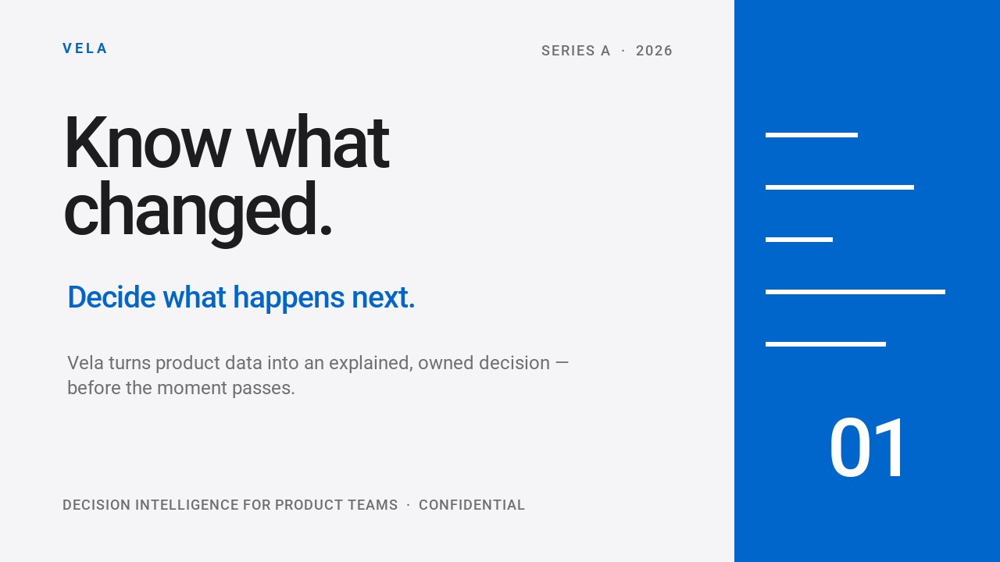

# プレゼンテーションと動画 { #presentations-and-video }

関連するレイアウトからサムネイル、ブラウザー用プレゼンテーション、アニメーション動画を作れます。[Orbit Atlasの例](#orbit-atlas)からは、次の成果物が得られます。

<div class="qt-gallery" markdown>


[](#orbit-atlas)
</div>

まずは小さな例から始めましょう。基本パッケージと内蔵フォントで、画像1枚、2枚のブラウザー用プレゼンテーション、アニメーションGIFを作ります。`creative_starter.py`として保存し、出力先にしたいディレクトリで実行してください。同名ファイルは上書きします。

```python
--8<-- "examples/creative_starter.py"
```

```bash
python -m pip install quickthumb
python creative_starter.py
```

作業ディレクトリの`creative-starter.png`、`creative-starter.html`、`creative-starter.gif`を開いてください。この入門例はシンプルな文字のレイアウトです。上のプレビューは、下にある完全版のOrbit Atlasから生成したものです。

以下の完全な作例も同じCanvasとDeck APIを使います。スクリプト、フォント、画像、音声はリポジトリにあります。[uv](https://docs.astral.sh/uv/)をインストールしてリポジトリをクローンし、実行してください。

```bash
git clone https://github.com/sjquant/quickthumb
cd quickthumb
```

## Cleaner Future { #cleaner-future }

スクリプト1つでクリエイター用サムネイル、4枚のプレゼンテーション、短いアニメーション動画を作ります。写真はAI生成で、文字、図形、レイアウト、アニメーションはquickthumbで構成しています。棒グラフは説明用で、実際の持続可能性データではありません。

```bash
uv run --no-default-groups python examples/cleaner_future.py --output-dir /tmp/cleaner-future --video
```

`python-for-creators.png`、4枚のスライドPNG、`cleaner-future.html`、`brighter-planet.mp4`を保存し、同名ファイルは上書きします。動画には`PATH`上のFFmpegが必要です。編集可能なPowerPointも作るには、`pptx`追加機能をインストールして`--pptx`を加えます。

```bash
uv run --no-default-groups --extra pptx python examples/cleaner_future.py --output-dir /tmp/cleaner-future --video --pptx
```

地球の静止画の上で見出しとアクセントが動く、無音の動画です。形式と代替表現の詳細は[ソース全体](https://github.com/sjquant/quickthumb/blob/main/examples/cleaner_future.py)と[エクスポートガイド](../exports.md)を参照してください。

## Orbit Atlas { #orbit-atlas }

架空の地図制作スタジオ向けに、スクリプト1つでサムネイル2枚、4枚のDeck、音付きの動画を作ります。数値はすべて説明用です。人物を含む同梱の元画像はAI生成で、文字、図形、動きはquickthumbのレイヤーです。音楽には[FupiのCC0「Synthwave House Loop」](https://opengameart.org/content/synthwave-house-loop)を使い、動画の128 BPMに合わせて調整しています。出典と変更内容は[音声素材の説明](https://github.com/sjquant/quickthumb/blob/main/assets/audio/README.md)にあります。

<video controls playsinline preload="none" poster="/assets/home/orbit-film-poster.webp">
<source src="/assets/home/orbit-film.mp4" type="video/mp4">
このブラウザーは動画に対応していません。<a href="/assets/home/orbit-film.mp4">動画をダウンロード</a>できます。
</video>


```bash
uv run --no-default-groups python examples/orbit_atlas.py --output-dir /tmp/orbit-atlas
```

`orbit-thumbnail-planet.webp`、`orbit-thumbnail-visuals.webp`、4枚の`orbit-slide-*.webp`、`orbit-deck.html`、`orbit-film.mp4`、`orbit-film-poster.webp`、3枚の`orbit-film-frame-*.webp`を保存し、同名ファイルは上書きします。動画には`PATH`または`QUICKTHUMB_FFMPEG`で指定したFFmpegが必要です。動画を省くには`--stills`を渡してください。PowerPointは`uv run`に`--extra pptx`、スクリプトに`--pptx`を追加します。

文字の登場エフェクトはHTMLとPowerPointで見え方が異なることがあります。出力先のアプリで確認してください。代替表現は[エクスポートの詳細](../exports.md)、作例の応用には[ソース全体](https://github.com/sjquant/quickthumb/blob/main/examples/orbit_atlas.py)を参照してください。

## 投資家向けDeck { #investor-deck }

Velaの例は、切り替え効果と発表者ノート付きのスライド10枚を作ります。会社のデータはすべて説明用です。同じDeckから、対話的なHTMLとPowerPointファイルを出力します。



```bash
uv run --extra pptx python examples/investor_deck.py
```

`examples/investor_deck.html`をブラウザーで、`examples/investor_deck.pptx`をPowerPointで開いてください。再実行すると上書きします。[ソース全体](https://github.com/sjquant/quickthumb/blob/main/examples/investor_deck.py)と[Deck API](../api/deck.md)も参照してください。

PowerPointには`pptx`追加機能が必要です。エフェクトや切り替えによっては、形式ごとの代替表現を使います。詳細は[エクスポートガイド](../exports.md)を参照してください。

## 製品紹介動画 { #product-reel }

文字アニメーション、グラフ、切り替え効果、ナレーション、音楽を8シーンに組み合わせた35秒の縦長動画です。実際の出力を再生してみてください。

<video controls playsinline preload="none" width="360" poster="/assets/home/product-hype-reel-poster.png">
<source src="/assets/home/product-hype-reel.mp4" type="video/mp4">
このブラウザーは動画に対応していません。<a href="/assets/home/product-hype-reel.mp4">製品紹介動画をダウンロード</a>できます。
</video>

```bash
uv run --extra pptx python examples/product_hype_reel.py
```

`examples/`へGIF、HTML、PowerPoint、MP4、WebMを保存し、同名ファイルは上書きします。MP4とWebMには`PATH`上のFFmpeg、PowerPointには`pptx`追加機能が必要です。[ソース全体](https://github.com/sjquant/quickthumb/blob/main/examples/product_hype_reel.py)は同梱のフォントと音声を使います。応用する際は[動画出力](../exports.md)と[アニメーションのタイミング](../timing.md)を参照してください。
