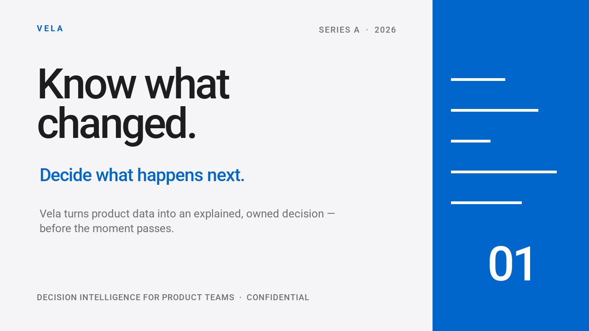

# 프레젠테이션과 동영상 { #presentations-and-video }

하나의 디자인을 바탕으로 썸네일과 브라우저용 프레젠테이션, 애니메이션 동영상을 만들어 봅니다.
[Orbit Atlas 예제](#orbit-atlas)는 다음 결과물을 생성합니다.

<div class="qt-gallery" markdown>


[](#orbit-atlas)
</div>

먼저 작은 예제로 시작하세요. 기본 패키지와 내장 글꼴로 이미지 하나, 두 장짜리 브라우저 프레젠테이션, 애니메이션 GIF를 렌더링합니다.
`creative_starter.py`로 저장하고 결과를 만들 디렉터리에서 실행하세요. 같은 이름의 파일을 덮어씁니다.

```python
--8<-- "examples/creative_starter.py"
```

```bash
python -m pip install quickthumb
python creative_starter.py
```

작업 디렉터리의 `creative-starter.png`, `creative-starter.html`, `creative-starter.gif`를 여세요.
시작 예제의 출력은 간단한 텍스트 레이아웃입니다. 위 미리보기는 아래의 더 완전한 Orbit Atlas 예제에서 생성했습니다.

아래의 완전한 예제도 같은 Canvas와 Deck API를 사용합니다.
스크립트, 글꼴, 이미지, 오디오는 저장소에 있습니다. 실행하려면 [uv](https://docs.astral.sh/uv/)를 설치하고 저장소를 복제하세요.

```bash
git clone https://github.com/sjquant/quickthumb
cd quickthumb
```

## Cleaner Future { #cleaner-future }

스크립트 하나로 크리에이터 썸네일, 네 장짜리 프레젠테이션, 짧은 애니메이션 동영상을 렌더링합니다.
사진은 AI로 생성했으며 텍스트, 도형, 레이아웃, 애니메이션은 quickthumb로 구성합니다.
막대 차트는 설명용이며 실제 지속가능성 데이터가 아닙니다.

```bash
uv run --no-default-groups python examples/cleaner_future.py --output-dir /tmp/cleaner-future --video
```

스크립트는 `python-for-creators.png`, 슬라이드 PNG 네 개, `cleaner-future.html`, `brighter-planet.mp4`를 기록합니다.
같은 이름의 기존 파일을 덮어씁니다. 동영상 내보내기에는 `PATH`의 FFmpeg가 필요합니다.
편집 가능한 PowerPoint도 만들려면 `pptx` 추가 기능을 설치하고 `--pptx`를 추가하세요.

```bash
uv run --no-default-groups --extra pptx python examples/cleaner_future.py --output-dir /tmp/cleaner-future --video --pptx
```

동영상은 지구 정지 이미지 위에 제목과 강조 요소를 애니메이션화하며 오디오는 없습니다.
형식 상세와 대체 표현은 [전체 소스](https://github.com/sjquant/quickthumb/blob/main/examples/cleaner_future.py)와 [내보내기 안내](../exports.md)를 참고하세요.

## Orbit Atlas {#orbit-atlas}

가상의 지도 제작 스튜디오를 위해 스크립트 하나로 썸네일 두 장, 네 장짜리 Deck, 소리 있는 동영상을 만듭니다.
모든 수치는 설명용입니다. 인물을 포함한 번들 소스 이미지는 AI로 생성했으며 글자, 도형, 모션은 quickthumb 레이어입니다.
사운드트랙은 [Fupi의 CC0 "Synthwave House Loop"](https://opengameart.org/content/synthwave-house-loop)를 영상의 128 BPM에 맞춰 조정했습니다.
소스와 변경 내용은 [오디오 출처 안내](https://github.com/sjquant/quickthumb/blob/main/assets/audio/README.md)에 기록되어 있습니다.

<video controls playsinline preload="none" poster="/assets/home/orbit-film-poster.webp">
<source src="/assets/home/orbit-film.mp4" type="video/mp4">
브라우저가 동영상을 지원하지 않습니다. <a href="/assets/home/orbit-film.mp4">동영상 다운로드</a>.
</video>


```bash
uv run --no-default-groups python examples/orbit_atlas.py --output-dir /tmp/orbit-atlas
```

스크립트는 `orbit-thumbnail-planet.webp`, `orbit-thumbnail-visuals.webp`, `orbit-slide-*.webp` 네 개, `orbit-deck.html`, `orbit-film.mp4`, `orbit-film-poster.webp`, `orbit-film-frame-*.webp` 정지 이미지 세 개를 기록하며 같은 이름의 파일을 덮어씁니다.
동영상에는 `PATH` 또는 `QUICKTHUMB_FFMPEG`로 지정한 FFmpeg가 필요합니다. 생략하려면 `--stills`를 전달하세요.
PowerPoint는 `uv run`에 `--extra pptx`, 스크립트에 `--pptx`를 추가합니다.

텍스트가 나타나는 효과는 HTML과 PowerPoint에서 다르게 보일 수 있으니 실제로 사용할 앱에서 확인하세요. 지원하지 않는 효과가 어떻게 대체되는지는 [내보내기 상세](../exports.md)에 설명되어 있습니다. 예제를 수정해 쓰려면 [전체 소스](https://github.com/sjquant/quickthumb/blob/main/examples/orbit_atlas.py)를 참고하세요.

## 투자자용 Deck { #investor-deck }

Vela 예제는 전환과 발표자 메모가 있는 슬라이드 열 장을 구성합니다. 모든 회사 데이터는 설명용입니다.
같은 Deck에서 대화형 HTML 프레젠테이션과 PowerPoint 파일을 내보냅니다.



```bash
uv run --extra pptx python examples/investor_deck.py
```

브라우저에서 `examples/investor_deck.html`을, PowerPoint에서 `examples/investor_deck.pptx`를 여세요.
다시 실행하면 이 파일들을 덮어씁니다.
[전체 소스](https://github.com/sjquant/quickthumb/blob/main/examples/investor_deck.py)와 [Deck API](../api/deck.md)를 참고하세요.

PowerPoint 출력에는 `pptx` 추가 기능이 필요합니다.
일부 효과나 전환은 형식에 따라 대체 표현을 사용할 수 있습니다. 자세한 내용은 [내보내기 안내](../exports.md)를 참고하세요.

## 제품 홍보 영상 { #product-reel }

35초짜리 세로형 제품 영상으로, 여덟 장면에 텍스트 애니메이션, 차트, 전환, 음성 해설, 사운드트랙을 조합합니다.
실제 출력물을 재생해 보세요.

<video controls playsinline preload="none" width="360" poster="/assets/home/product-hype-reel-poster.png">
<source src="/assets/home/product-hype-reel.mp4" type="video/mp4">
브라우저가 동영상을 지원하지 않습니다. <a href="/assets/home/product-hype-reel.mp4">제품 홍보 영상 다운로드</a>.
</video>

```bash
uv run --extra pptx python examples/product_hype_reel.py
```

스크립트는 `examples/`에 GIF, HTML, PowerPoint, MP4, WebM을 기록하며 같은 이름의 출력을 덮어씁니다.
MP4와 WebM에는 `PATH`의 FFmpeg가, PowerPoint에는 `pptx` 추가 기능이 필요합니다.
[전체 소스](https://github.com/sjquant/quickthumb/blob/main/examples/product_hype_reel.py)는 번들 글꼴과 오디오를 사용합니다.
응용 방법은 [동영상 내보내기](../exports.md)와 [애니메이션 타이밍](../timing.md)을 참고하세요.
