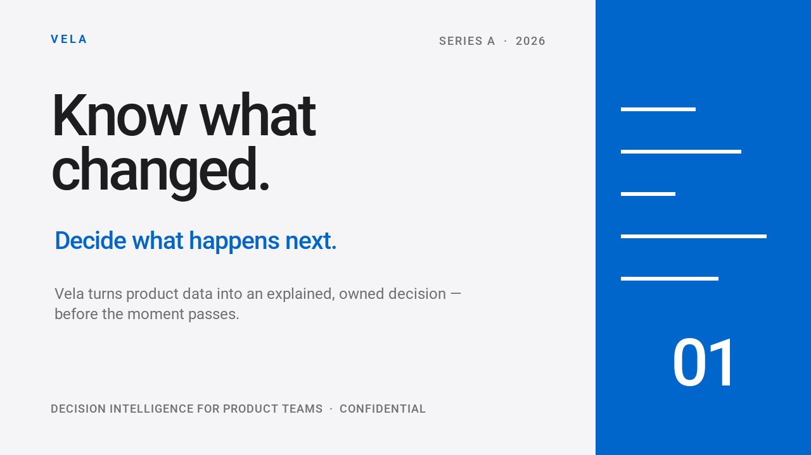

# Presentations and video

Create a thumbnail, a browser presentation, and an animated video from related
layouts. The [Orbit Atlas example](#orbit-atlas) produces these results:

<div class="qt-gallery" markdown>


[](#orbit-atlas)
</div>

Start with this small example: it renders one image, a two-slide browser
presentation, and an animated GIF using the base package and built-in font.
Save it as `creative_starter.py` and run it in the directory where you want the
files; it replaces files with the same names.

```python
--8<-- "examples/creative_starter.py"
```

```bash
python -m pip install quickthumb
python creative_starter.py
```

Open `creative-starter.png`, `creative-starter.html`, and `creative-starter.gif`
in the working directory. These starter outputs use a simple text layout; the
previews above come from the fuller Orbit Atlas example below.

The complete examples below use the same Canvas and Deck APIs. Their scripts,
fonts, images, and audio are in the repository. Install [uv](https://docs.astral.sh/uv/)
and clone the repository to run them:

```bash
git clone https://github.com/sjquant/quickthumb
cd quickthumb
```

## Cleaner Future

One script renders a creator thumbnail, a four-slide presentation, and a short
animated video. The photographs are AI-generated;
the text, shapes, layout, and animation are composed with quickthumb. The bar
chart is illustrative, not real sustainability data.

```bash
uv run --no-default-groups python examples/cleaner_future.py --output-dir /tmp/cleaner-future --video
```

The script writes `python-for-creators.png`, four slide PNGs,
`cleaner-future.html`, and `brighter-planet.mp4`. Existing files with those
names are replaced. Video export requires FFmpeg on `PATH`. To also create an
editable PowerPoint presentation, install the `pptx` extra and add `--pptx`:

```bash
uv run --no-default-groups --extra pptx python examples/cleaner_future.py --output-dir /tmp/cleaner-future --video --pptx
```

The video animates the headline and accent over a still Earth image; it has no
audio. See the [complete source](https://github.com/sjquant/quickthumb/blob/main/examples/cleaner_future.py)
and the [export guide](../exports.md) for format details and fallbacks.

## Orbit Atlas

One script renders two thumbnails, a four-slide deck, and a video with sound for a
fictional mapping studio. All figures are illustrative. The bundled source images,
including the people, are AI-generated; the type, shapes, and motion are quickthumb
layers. The soundtrack is [Fupi's CC0 "Synthwave House Loop"](https://opengameart.org/content/synthwave-house-loop),
retimed to the film's 128 BPM. The [audio source notes](https://github.com/sjquant/quickthumb/blob/main/assets/audio/README.md) record the source and changes.

<video controls playsinline preload="none" poster="../../assets/home/orbit-film-poster.webp">
<source src="../../assets/home/orbit-film.mp4" type="video/mp4">
Your browser does not support video. <a href="../../assets/home/orbit-film.mp4">Download the video</a>.
</video>


```bash
uv run --no-default-groups python examples/orbit_atlas.py --output-dir /tmp/orbit-atlas
```

The script writes `orbit-thumbnail-planet.webp`, `orbit-thumbnail-visuals.webp`, four
`orbit-slide-*.webp` files, `orbit-deck.html`, `orbit-film.mp4`,
`orbit-film-poster.webp`, and three `orbit-film-frame-*.webp` stills, replacing
files with those names. Video needs FFmpeg on
`PATH` or in `QUICKTHUMB_FFMPEG`; pass `--stills` to skip it. For PowerPoint, add
`--extra pptx` to `uv run` and `--pptx` to the script.

Text entrances can look different in HTML and PowerPoint. Check the deck in its
target app; see [export details](../exports.md) for fallbacks and the
[complete source](https://github.com/sjquant/quickthumb/blob/main/examples/orbit_atlas.py)
to adapt the example.

## Investor deck

The Vela example builds ten slides with transitions and speaker notes. All
company data is illustrative. It exports an interactive HTML presentation and a
PowerPoint file from the same deck.



```bash
uv run --extra pptx python examples/investor_deck.py
```

Open `examples/investor_deck.html` in a browser or
`examples/investor_deck.pptx` in PowerPoint. The script overwrites these files
when run again. See the [complete source](https://github.com/sjquant/quickthumb/blob/main/examples/investor_deck.py)
and the [Deck API](../api/deck.md).

PowerPoint output requires the `pptx` extra. Some effects or transitions may use
fallbacks in a given format; consult the [export guide](../exports.md) for details.

## Product reel

This 35-second vertical product video combines eight scenes with animated text,
charts, transitions, voiceovers, and a soundtrack. Play the actual output:

<video controls playsinline preload="none" width="360" poster="../../assets/home/product-hype-reel-poster.png">
<source src="../../assets/home/product-hype-reel.mp4" type="video/mp4">
Your browser does not support video. <a href="../../assets/home/product-hype-reel.mp4">Download the product reel</a>.
</video>

```bash
uv run --extra pptx python examples/product_hype_reel.py
```

The script writes GIF, HTML, PowerPoint, MP4, and WebM files in `examples/`,
replacing outputs of the same name. MP4 and WebM need FFmpeg on `PATH`;
PowerPoint needs the `pptx` extra. The [complete source](https://github.com/sjquant/quickthumb/blob/main/examples/product_hype_reel.py)
uses bundled fonts and audio. Read about [video exports](../exports.md) and
[animation timing](../timing.md) to adapt it.
