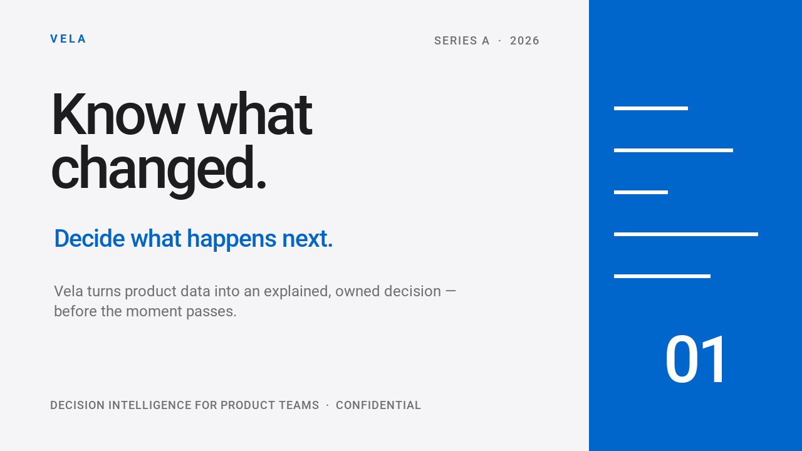

# 演示文稿与视频 { #presentations-and-video }

基于相互关联的版式设计，制作缩略图、浏览器演示文稿和动画视频。[Orbit Atlas 示例](#orbit-atlas)可生成以下成果：

<div class="qt-gallery" markdown>


[](#orbit-atlas)
</div>

从这个入门级精简示例开始：它仅使用基础包和内置字体，即可渲染出一张图片、一份双页浏览器演示文稿和一个动画 GIF。
将其保存为 `creative_starter.py` 并在期望输出文件的目录下运行；多次运行将覆盖同名文件。

```python
--8<-- "examples/creative_starter.py"
```

```bash
python -m pip install quickthumb
python creative_starter.py
```

在当前工作目录下打开 `creative-starter.png`、`creative-starter.html` 和 `creative-starter.gif`。这些入门产物采用了简单的文本版式；上方画廊中的精美视觉效果则来自后文更完整的 Orbit Atlas 示例。

以下完整示例使用了相同的 Canvas 和 Deck API。相关脚本、字体、图片及音频均已包含在代码仓库中。安装 [uv](https://docs.astral.sh/uv/) 并克隆代码仓库即可运行：

```bash
git clone https://github.com/sjquant/quickthumb
cd quickthumb
```

## Cleaner Future { #cleaner-future }

一段脚本同时渲染出一张创作者缩略图、一份四页演示文稿和一个简短的动画视频。示例中的照片为 AI 生成；文字、形状、排版和动画均使用 quickthumb 进行编排。其中的柱状图仅用于示例展示，并非真实的可持续发展统计数据。

```bash
uv run --no-default-groups python examples/cleaner_future.py --output-dir /tmp/cleaner-future --video
```

该脚本会输出 `python-for-creators.png`、四张幻灯片 PNG 图片、`cleaner-future.html` 以及 `brighter-planet.mp4`。同名旧文件将被直接覆盖。视频导出要求系统 `PATH` 中包含 FFmpeg。如需同时生成可编辑的 PowerPoint 演示文稿，请安装 `pptx` 额外依赖并加上 `--pptx` 参数：

```bash
uv run --no-default-groups --extra pptx python examples/cleaner_future.py --output-dir /tmp/cleaner-future --video --pptx
```

该视频让标题文字和强调色在静止的地球背景图上动起来；不包含音频。完整代码请参阅[完整源码](https://github.com/sjquant/quickthumb/blob/main/examples/cleaner_future.py)；格式细节与降级方案请参阅[导出指南](../exports.md)。

## Orbit Atlas {#orbit-atlas}

一段脚本为一家虚构的测绘工作室渲染出两张缩略图、一份四页幻灯片以及一段带有声音的视频。所有图表数据仅为示例。内置的素材图片（包括人物）均为 AI 生成；文字排版、图形与动效均为 quickthumb 图层。背景原声带选自 [Fupi 的 CC0 授权作品“Synthwave House Loop”](https://opengameart.org/content/synthwave-house-loop)，并重新对齐至视频的 128 BPM 节奏。[音频来源说明](https://github.com/sjquant/quickthumb/blob/main/assets/audio/README.md)详细记录了出处与修改信息。

<video controls playsinline preload="none" poster="/assets/home/orbit-film-poster.webp">
<source src="/assets/home/orbit-film.mp4" type="video/mp4">
您的浏览器不支持视频播放。<a href="/assets/home/orbit-film.mp4">下载视频</a>。
</video>


```bash
uv run --no-default-groups python examples/orbit_atlas.py --output-dir /tmp/orbit-atlas
```

该脚本会生成 `orbit-thumbnail-planet.webp`、`orbit-thumbnail-visuals.webp`、四份 `orbit-slide-*.webp` 文件、`orbit-deck.html`、`orbit-film.mp4`、`orbit-film-poster.webp` 以及三张 `orbit-film-frame-*.webp` 静止画面，并覆盖同名文件。视频生成需要系统 `PATH` 中或 `QUICKTHUMB_FFMPEG` 变量指向 FFmpeg；传入 `--stills` 可跳过视频渲染。如需 PowerPoint 文件，请在 `uv run` 中添加 `--extra pptx`，并在脚本参数中加上 `--pptx`。

文本入场动效在 HTML 和 PowerPoint 中的呈现效果可能会有所不同。请在目标应用中实际核对幻灯片效果；有关降级方案请参阅[导出参考](../exports.md)，查看[完整源码](https://github.com/sjquant/quickthumb/blob/main/examples/orbit_atlas.py)可了解如何调整本示例。

## 投资者演示文稿 { #investor-deck }

Vela 示例构建了十页包含转场过渡和演讲者备注的幻灯片。所有公司数据均为虚拟示例。它从同一个 Deck 分别导出交互式 HTML 演示文稿和 PowerPoint 文件。



```bash
uv run --extra pptx python examples/investor_deck.py
```

在浏览器中打开 `examples/investor_deck.html` 或在 PowerPoint 中打开 `examples/investor_deck.pptx`。再次运行时脚本将覆盖这些文件。参阅[完整源码](https://github.com/sjquant/quickthumb/blob/main/examples/investor_deck.py)与 [Deck API](../api/deck.md)。

PowerPoint 导出需要 `pptx` 额外依赖。某些视觉效果或转场在特定格式中可能会采用降级策略；详情请参阅[导出指南](../exports.md)。

## 产品宣传片 { #product-reel }

这段 35 秒的竖版产品宣传视频融合了八个场景，包含动态文字、图表、场景转场、配音旁白以及背景音乐原声带。点击播放实际输出产物：

<video controls playsinline preload="none" width="360" poster="/assets/home/product-hype-reel-poster.png">
<source src="/assets/home/product-hype-reel.mp4" type="video/mp4">
您的浏览器不支持视频播放。<a href="/assets/home/product-hype-reel.mp4">下载产品宣传片</a>。
</video>

```bash
uv run --extra pptx python examples/product_hype_reel.py
```

该脚本会在 `examples/` 目录下写入 GIF、HTML、PowerPoint、MP4 和 WebM 文件，并覆盖同名旧文件。MP4 和 WebM 要求 `PATH` 中包含 FFmpeg；PowerPoint 需要 `pptx` 额外依赖。[完整源码](https://github.com/sjquant/quickthumb/blob/main/examples/product_hype_reel.py)直接使用了内置字体和音频。如需二次开发调整，请阅读[视频导出](../exports.md)与[动画时间控制](../timing.md)。
