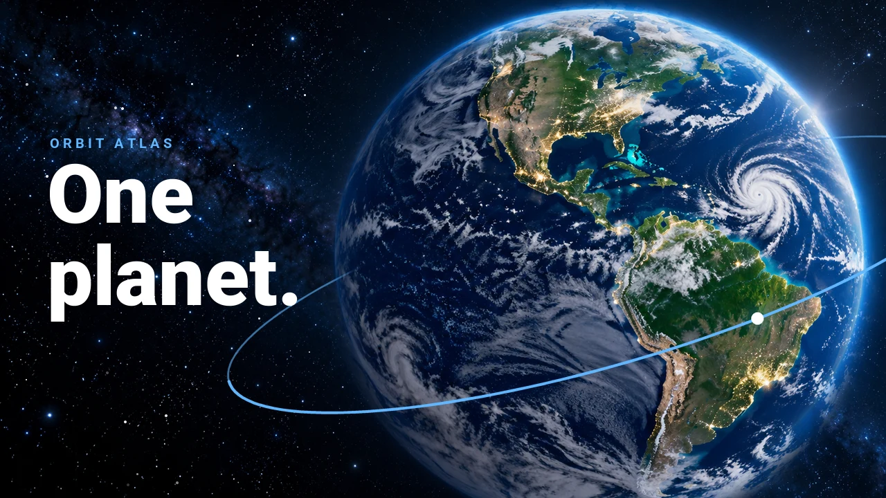
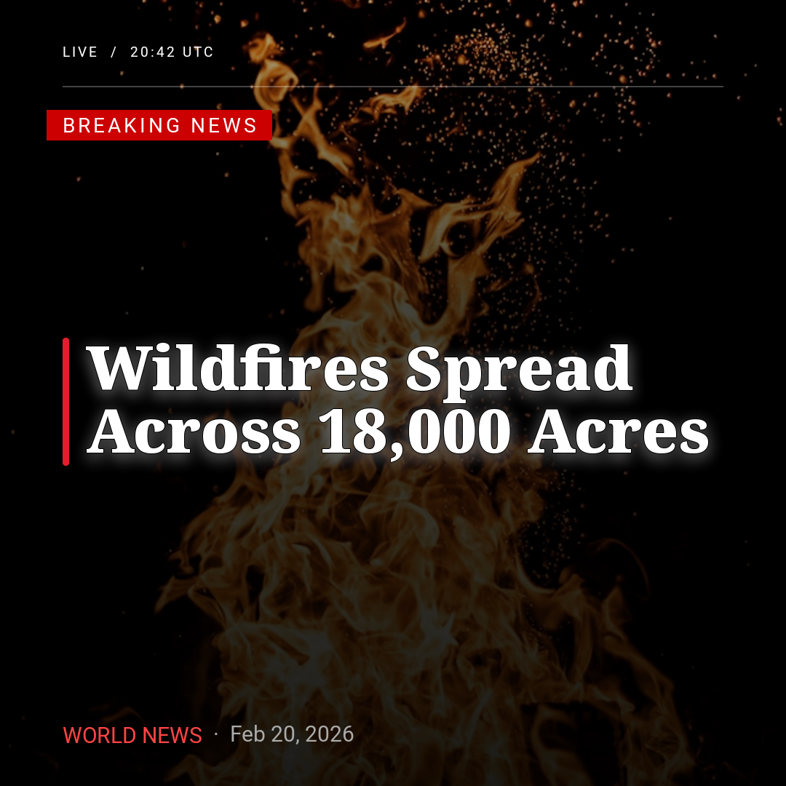
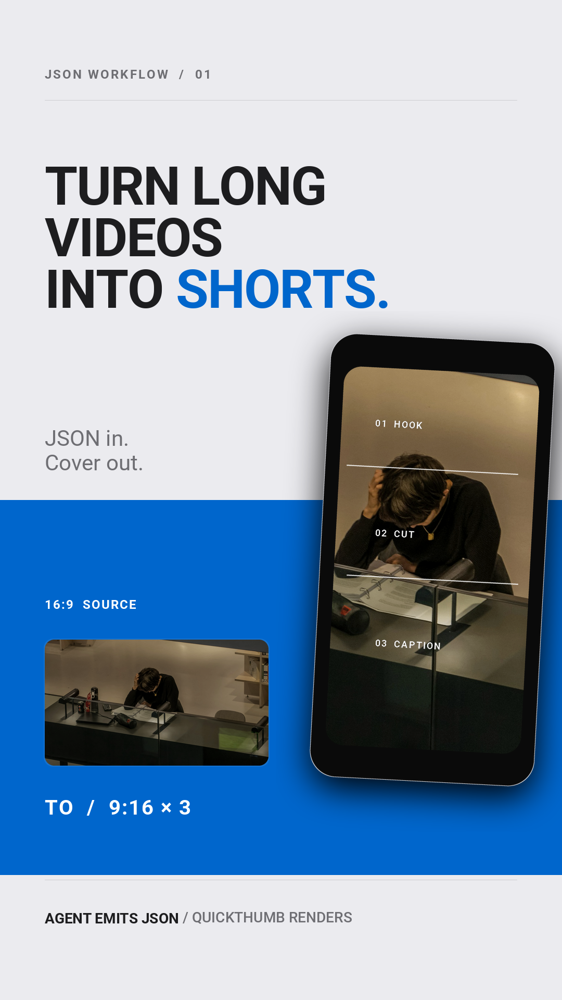
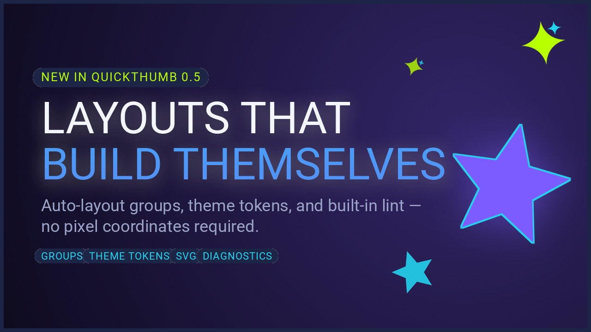

# 레시피 모음 { #cookbook }

만들고 싶은 이미지나 프레젠테이션, 동영상을 골라 보세요. 미리보기는 각각 연결된 예제로 만든 결과물입니다. 예제의 텍스트와 이미지, 색상을 바꾸면 자신의 작업에 바로 응용할 수 있습니다.

## 프레젠테이션과 동영상 { #presentations-and-video }

<div class="qt-gallery" markdown>
<figure markdown="span">
[](decks-and-video.md#orbit-atlas)
<figcaption>프레젠테이션과 슬라이드</figcaption>
</figure>
<figure markdown="span">
[](decks-and-video.md#orbit-atlas)
<figcaption>애니메이션 동영상</figcaption>
</figure>
</div>

[프레젠테이션과 동영상 예제 보기 →](decks-and-video.md)

## 이미지와 그래픽 { #images-and-graphics }

<div class="qt-gallery qt-gallery--cookbook" markdown>
<figure markdown="span">
[](youtube-thumbnail.md#before-after)
<figcaption>YouTube 썸네일</figcaption>
</figure>
<figure markdown="span">
[](youtube-thumbnail.md#burnout)
<figcaption>번아웃 주제</figcaption>
</figure>
<figure markdown="span">
[](instagram-card.md)
<figcaption>Instagram 뉴스 카드</figcaption>
</figure>
<figure markdown="span">
[](youtube-thumbnail.md#talking-head)
<figcaption>발표자 인물 사진</figcaption>
</figure>
<figure markdown="span">
[](youtube-thumbnail.md#reaction)
<figcaption>반응 / 해설</figcaption>
</figure>
<figure markdown="span">
[](youtube-thumbnail.md#tutorial)
<figcaption>튜토리얼 / 설명</figcaption>
</figure>
<figure markdown="span">
[](podcast-promo.md)
<figcaption>팟캐스트 홍보</figcaption>
</figure>
<figure markdown="span">
[](shorts-cover.md)
<figcaption>Shorts / 세로형 커버</figcaption>
</figure>
<figure markdown="span">
[](launch-announcement.md)
<figcaption>출시 알림</figcaption>
</figure>
</div>

## 더 다양한 제작 방법 { #more-ways-to-create }

- [첫 카드 렌더링](../getting-started.md): 저장소를 복제하지 않고 레이아웃 하나를 재사용합니다.
- [AI 작업 흐름](ai-workflow.md): JSON 레이아웃을 생성·검증하고 렌더링합니다.
- [웹 글꼴과 배경 제거](webfonts-rembg.md): 서체를 추가하거나 인물 배경을 제거합니다.

## 레시피 실행 { #running-the-recipes }

대부분의 레시피는 저장소에 포함된 글꼴과 사진을 사용합니다.
[uv](https://docs.astral.sh/uv/)를 설치한 뒤 복제한 저장소에서 실행하세요.

```bash
git clone https://github.com/sjquant/quickthumb
cd quickthumb
uv run python examples/instagram_news_card.py
```

YouTube 레이아웃 두 개는 `remove_background=True`로 인물 배경을 제거합니다.
Python 3.11 이상이 필요한 `rembg` 추가 기능을 설치해야 합니다.

```bash
uv run --extra rembg python examples/youtube_reaction.py
```
