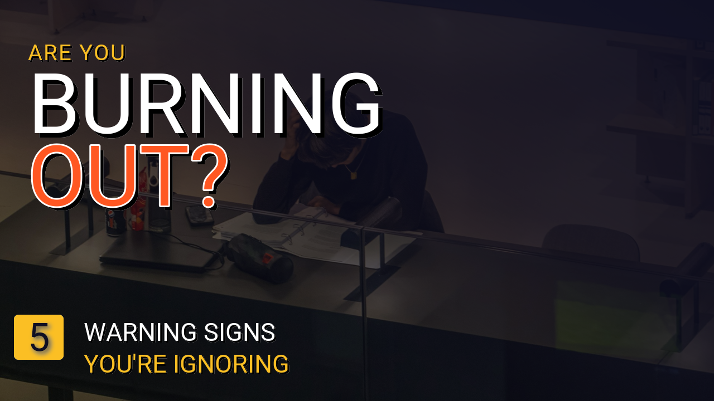
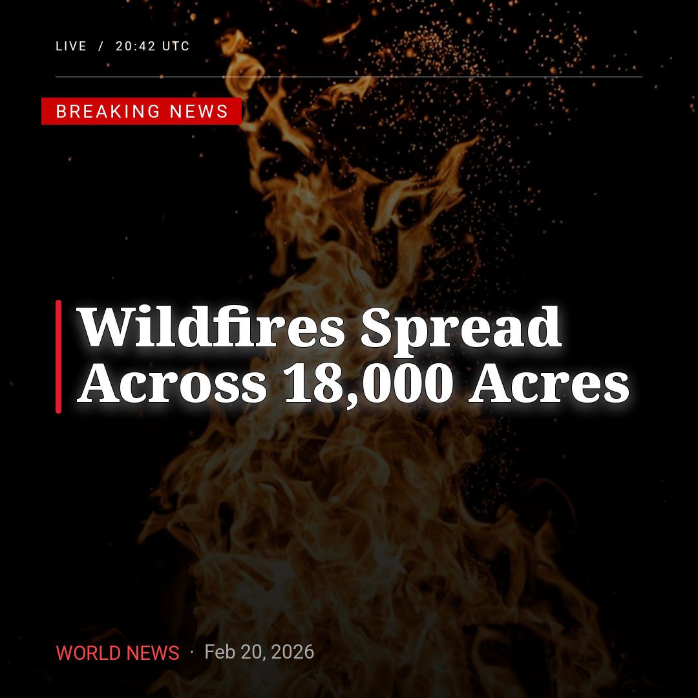
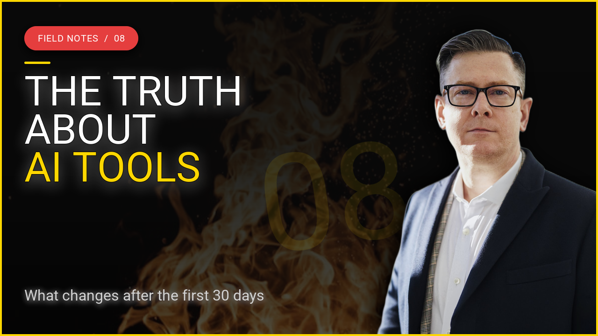
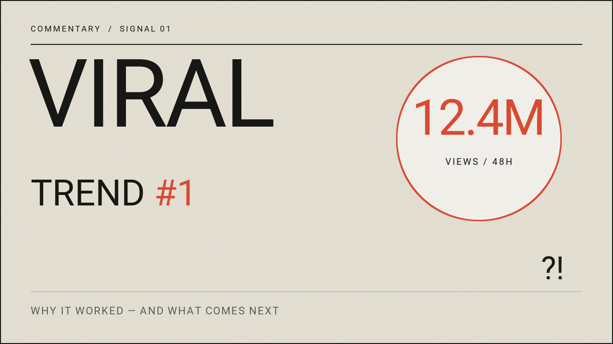
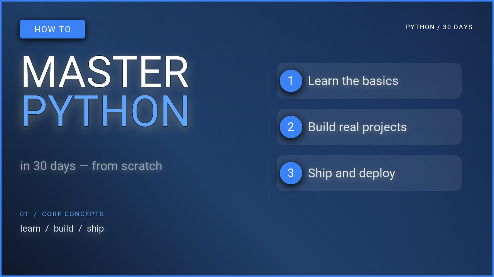
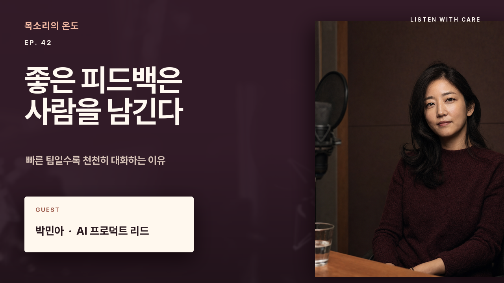
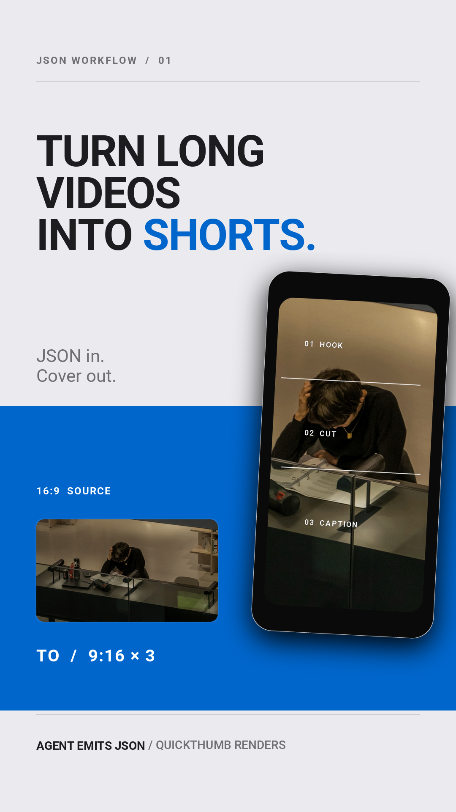

# Cookbook

Choose a layout for the content you publish, then adapt its text, images, and colors.
Each preview was rendered by the exact script shown on its recipe page.
For a small example that renders several cards from one layout, start with
[Render your first cards](../getting-started.md).

## Gallery

<div class="qt-gallery qt-gallery--cookbook" markdown>
<figure markdown="span">
[](youtube-thumbnail.md#before-after)
<figcaption>YouTube thumbnail</figcaption>
</figure>
<figure markdown="span">
[](youtube-thumbnail.md#burnout)
<figcaption>Burnout theme</figcaption>
</figure>
<figure markdown="span">
[](instagram-card.md)
<figcaption>Instagram news card</figcaption>
</figure>
<figure markdown="span">
[](youtube-thumbnail.md#talking-head)
<figcaption>Talking head</figcaption>
</figure>
<figure markdown="span">
[](youtube-thumbnail.md#reaction)
<figcaption>Reaction / commentary</figcaption>
</figure>
<figure markdown="span">
[](youtube-thumbnail.md#tutorial)
<figcaption>Tutorial / explainer</figcaption>
</figure>
<figure markdown="span">
[](podcast-promo.md)
<figcaption>Podcast promo</figcaption>
</figure>
<figure markdown="span">
[](shorts-cover.md)
<figcaption>Shorts / vertical cover</figcaption>
</figure>
<figure markdown="span">
[](launch-announcement.md)
<figcaption>Launch announcement</figcaption>
</figure>
</div>

## Recipes

| Recipe | Size | Use it to… |
| --- | --- | --- |
| [YouTube Thumbnails](youtube-thumbnail.md) | 1280×720 | Give a comparison, commentary, or tutorial video a cover |
| [Instagram Card](instagram-card.md) | 1080×1080 | Pair a news headline with a photograph for a square social post |
| [Podcast Promo](podcast-promo.md) | 1280×720 | Introduce a podcast episode with its title and guest portrait |
| [Shorts / Vertical Cover](shorts-cover.md) | 1080×1920 | Make a vertical video cover from a JSON layout |
| [Launch Announcement](launch-announcement.md) | 1280×720 | Reuse a release card with new copy and brand colors |
| [AI Workflow](ai-workflow.md) | Any | Have an LLM draft a layout, then validate and render its spec |
| [Webfonts & Background Removal](webfonts-rembg.md) | Any | Add a chosen typeface or place a cut-out portrait in a design |

## Running the recipes

The scripts use fonts and photos bundled in the repository, so run them from a
clone:

```bash
git clone https://github.com/sjquant/quickthumb
cd quickthumb
uv run python examples/instagram_news_card.py
```

Two of the YouTube layouts cut out a portrait with `remove_background=True`.
They need the `rembg` extra, which requires Python 3.11 or later:

```bash
uv run --extra rembg python examples/youtube_reaction.py
```
