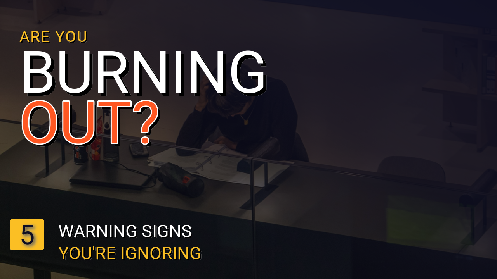
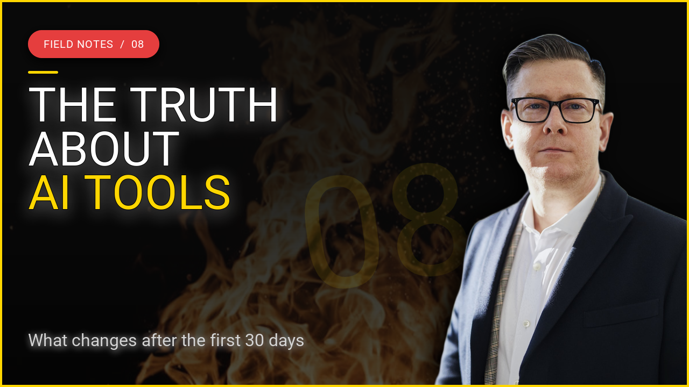
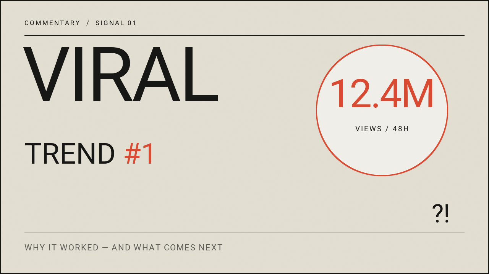
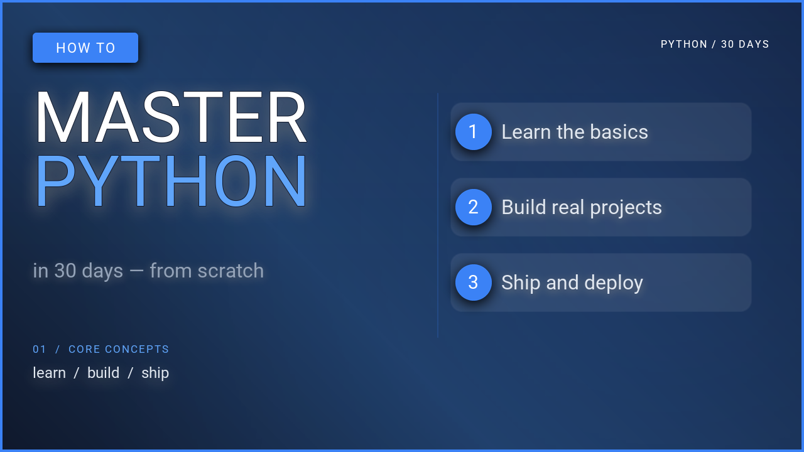

# YouTube 缩略图 { #youtube-thumbnails }

五款 1280×720 版式。下方展示的每张图片均由其下方的脚本直接渲染生成，脚本文件位于代码仓库的 `examples/` 目录中。

要运行其中任意一个，请安装 [uv](https://docs.astral.sh/uv/)，克隆代码仓库，并在仓库根目录下执行脚本。脚本会从 `assets/` 加载素材并将 PNG 图片写入 `examples/`，同时覆盖同名旧文件。

```bash
git clone https://github.com/sjquant/quickthumb
cd quickthumb
uv run python examples/youtube_thumbnail_01.py
```

## 前后对比卡片 { #before-after }


照片背景，左侧为主标题，右侧是两张倾斜卡片，将核心卖点具象化呈现。

- 水平 `LinearGradient` 从接近纯黑过渡到完全透明，使左半部分足够暗以保证文字清晰可读，同时右侧仍能透出背景照片。
- 三行主标题合并为一个 `.text()` 图层，由各自具备独立字号与颜色的 `TextPart` 构成。
- 两张卡片是带有 `Stroke` 描边的旋转 `rectangle` 形状；前景卡片还投射了 `Shadow` 投影。每张卡片上的文字均采用相同的 `rotation` 旋转角度。

??? example "examples/youtube_thumbnail_01.py"

    ```python
    --8<-- "examples/youtube_thumbnail_01.py"
    ```

## 醒目的提问 { #burnout }



在大幅降低饱和度的照片背景上，醒目地放置一个超大字号的问题。

- `Filter(saturation=0.32)` 降低了照片的色彩饱和度，使橙色强调色成为全图唯一的鲜艳色彩。
- 主标题的每一行均为固定像素位置的独立文本图层，从而能精细控制行间距。
- 引导文案上方的细分割线是一个 1px 高的 `#FFFFFF33` 矩形（20% 不透明度的白色）。

??? example "examples/youtube_thumbnail_02.py"

    ```python
    --8<-- "examples/youtube_thumbnail_02.py"
    ```

## 出镜人像 { #talking-head }



左侧为主标题，右侧是演讲者人像。

- 人像通过 URL 下载，并使用 `remove_background=True` 完成自动抠图。这需要安装 `rembg` 额外依赖（支持 Python 3.11+）和网络连接：
  `uv run --extra rembg python examples/youtube_talking_head.py`。
- `position=(1280, 720)` 配合 `align=("right", "bottom")`，无论人像素材实际尺寸多大，都能将其固定在画布右下角。
- `max_width="55%"` 确保主标题在触及人像之前自动折行。

??? example "examples/youtube_talking_head.py"

    ```python
    --8<-- "examples/youtube_talking_head.py"
    ```

## 反应 / 解说 { #reaction }



醒目的关键词、巨大的数字与充满情绪的面部表情。

- 居中置于人像后方的 `RadialGradient` 径向渐变增添了微弱的红光光晕。顶层的 `LinearGradient` 则保持文本一侧的深色背景。
- 底层作为大背景的 `#1` 是一个 470px、不透明度为 13% 的超大文本图层。
- 人像使用了 `remove_background=True`（需要 `rembg` 额外依赖）与 `Filter(saturation=0.08)`，几乎呈现为黑白质感。

??? example "examples/youtube_reaction.py"

    ```python
    --8<-- "examples/youtube_reaction.py"
    ```

## 教程 / 解说 { #tutorial }



无需任何摄影照片：主标题、蓝色面板和几行“代码”。

- 面板上的代码为一个统一的文本图层。每个 `TextPart` 设置各自的颜色与字重，轻松模拟出代码语法高亮的效果。
- 配色方案抽离为模块级常量（`BLUE`、`WHITE`、`GRAY`），更换缩略图风格只需修改三行定义。

??? example "examples/youtube_tutorial_explainer.py"

    ```python
    --8<-- "examples/youtube_tutorial_explainer.py"
    ```
