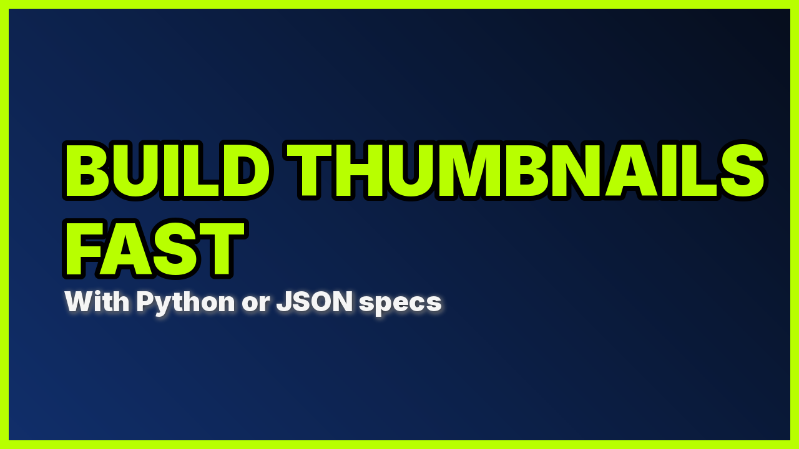

# Getting Started

This guide walks through the core workflow: create a canvas, add layers, and export an image.

## First export without fonts or downloads

First install [the current checkout's wheel in an isolated environment](installation.md#isolated-environment);
the published 0.7.0 release does not include this `export()` API. In the working
directory outside the checkout, save this as `first_export.py`. It needs only
the base package and local disk:

```python
from pathlib import Path

from quickthumb import Canvas

canvas = Canvas(320, 180).background(color="#102030").shape(
    "rectangle", position=(24, 24), width=96, height=64, color="#42CEB7",
)
Path("scene.json").write_text(canvas.to_json(), encoding="utf-8")
result = canvas.export("first.png")
print(result.written_paths)
print(result.pixel_metrics.width, result.pixel_metrics.height)
```

Run `python first_export.py`. It writes `first.png` (320 × 180) and the
canonical scene description `scene.json`. `result` is an export receipt,
separate from the editable scene JSON; the example prints its paths and dimensions.
See [the output API](exports.md#recommended-output-api) for diagnostics and other
receipt fields.

With the `cli` extra installed, check requirements and render that same scene:

```bash
quickthumb doctor png --spec scene.json -o from-json.png
quickthumb render scene.json -o from-json.png
```

`doctor` checks discovered requirements and write permissions; the render command
is the actual output check. [Diagnostics & CLI](diagnostics.md#quickthumb-doctor)
explains its limits. [JSON round trips](json-schema.md#round-trip-serialization)
explain what the scene file carries.

## Add typography to your thumbnail

This next example downloads Inter from Google Fonts on first use. It needs
network access then, or a previously populated font cache. Use a local font path
instead when working offline; the first export above needs no font setup.

```python
from quickthumb import Canvas, LinearGradient, Shadow, Stroke, TextPart

canvas = (
    Canvas.from_aspect_ratio("16:9", base_width=1280)
    .background(
        gradient=LinearGradient(
            angle=135,
            stops=[("#0A1730", 0.0), ("#1F56C5", 1.0)],
        ),
    )
    .background(color="#000000", opacity=0.45)
    .text(
        content=[
            TextPart(
                text="BUILD THUMBNAILS\nFAST\n",
                color="#B8FF00",
                effects=[Stroke(width=8, color="#000000")],
            ),
            TextPart(
                text="With Python or JSON specs",
                color="#F5F5F5",
                size=44,
                effects=[Shadow(offset_x=2, offset_y=2, color="#000000", blur_radius=4)],
            ),
        ],
        font="Inter",
        font_source="google",
        size=112,
        position=("8%", "50%"),
        align=("left", "middle"),
        weight=900,
    )
    .outline(width=14, color="#B8FF00")
)

canvas.render("thumbnail.png")
```

<figure class="qt-output" markdown="span">

<figcaption>thumbnail.png · 1280 × 720</figcaption>
</figure>

## Step by step

### 1. Create a canvas

```python
from quickthumb import Canvas

# Explicit size
canvas = Canvas(1280, 720)

# Or from an aspect ratio
canvas = Canvas.from_aspect_ratio("16:9", base_width=1280)
canvas = Canvas.from_aspect_ratio("1:1", base_width=1080)
canvas = Canvas.from_aspect_ratio("9:16", base_width=1080)
```

### 2. Add a background

```python
from quickthumb import Canvas, Filter, LinearGradient

canvas = (
    Canvas(1280, 720)
    # Solid color
    .background(color="#0F172A")
    # Gradient overlay
    .background(
        gradient=LinearGradient(
            angle=120,
            stops=[("#111827", 0.0), ("#11182700", 1.0)],
        ),
        opacity=0.7,
    )
    # Remote image with effects
    .background(
        image="https://images.unsplash.com/photo-1516321318423-f06f85e504b3",
        fit="cover",
        blend_mode="multiply",
        effects=[Filter(blur=4, brightness=0.75)],
    )
)
```

Layers stack in call order: the first `.background()` is drawn first, at the back.

### 3. Add text

```python
from quickthumb import Background, Glow, Shadow, Stroke, TextPart

canvas.text(
    content=[
        TextPart(text="5 ", color="#FBBF24", weight=900),
        TextPart(text="WARNING SIGNS", color="#FFFFFF", weight=900),
    ],
    size=72,
    position=(80, 540),
    effects=[
        Background(color="#111827CC", padding=(16, 22), border_radius=12),
        Stroke(width=2, color="#000000"),
        Shadow(offset_x=4, offset_y=4, color="#000000", blur_radius=8),
        Glow(color="#F59E0B", radius=14, opacity=0.35),
    ],
)
```

`content` can also be a plain string for simple cases:

```python
canvas.text(content="Hello World", size=64, color="#FFFFFF", align="center")
```

### 4. Add an image

```python
from quickthumb import Filter, Shadow

canvas.image(
    path="portrait.png",
    position=("73%", "52%"),
    width=420,
    height=520,
    fit="cover",
    align=("center", "middle"),
    border_radius=24,
    effects=[
        Filter(contrast=1.1, saturation=1.05),
        Shadow(offset_x=0, offset_y=12, color="#000000", blur_radius=24),
    ],
)
```

### 5. Add shapes

```python
from quickthumb import Shadow, Stroke

canvas.shape(
    shape="rectangle",
    position=(64, 60),
    width=320,
    height=88,
    color="#CC0000",
    border_radius=10,
    effects=[
        Stroke(width=2, color="#FFFFFF"),
        Shadow(offset_x=0, offset_y=6, color="#000000", blur_radius=12),
    ],
)
```

### 6. Check your work

`diagnose()` flags common problems before you render, such as layers off the canvas, text too small to read, words that can't wrap, and low contrast:

```python
for finding in canvas.diagnose().findings:
    print(finding.severity, finding.code, finding.message)
```

An empty `findings` list means the composition is clean. See [Diagnostics & CLI](diagnostics.md).

### 7. Export

```python
# PNG file
canvas.render("output.png")

# JPEG or WebP with quality
canvas.render("output.webp", format="WEBP", quality=90)
canvas.render("output.jpg", format="JPEG", quality=85)

# Base64 string
png_b64 = canvas.to_base64(format="PNG")

# Data URL (e.g. for HTML src=)
data_url = canvas.to_data_url(format="JPEG", quality=90)
```

## JSON workflow

You can also drive quickthumb from a JSON config instead of Python code:

```python
from quickthumb import Canvas

config = """
{
  "kind": "canvas",
  "width": 1280,
  "height": 720,
  "layers": [
    { "type": "background", "color": "#111827" },
    {
      "type": "text",
      "content": "Hello quickthumb",
      "size": 72,
      "color": "#FFFFFF",
      "align": "center",
      "position": ["50%", "50%"]
    },
    { "type": "outline", "width": 10, "color": "#22C55E" }
  ]
}
"""

canvas = Canvas.from_json(config)
canvas.render("hello.png")
```

This is particularly useful for AI-generated specs. See [JSON Schema & AI Workflow](json-schema.md) for details.

## Next steps

- [Core Concepts](concepts.md): how layers, effects, and positioning work
- [Group (Auto Layout)](api/group.md): stack layers in rows and columns without placing each one
- [API Reference](api/index.md): every parameter of every layer type
- [Diagnostics & CLI](diagnostics.md): lint specs and render from the terminal
- [Cookbook](cookbook/index.md): complete examples with the images they produce
