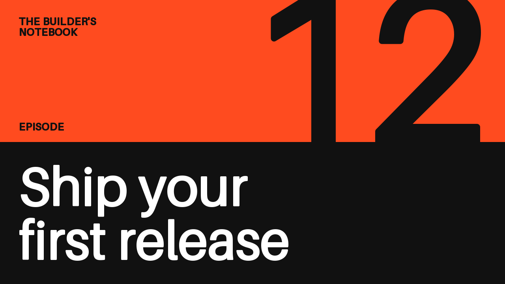
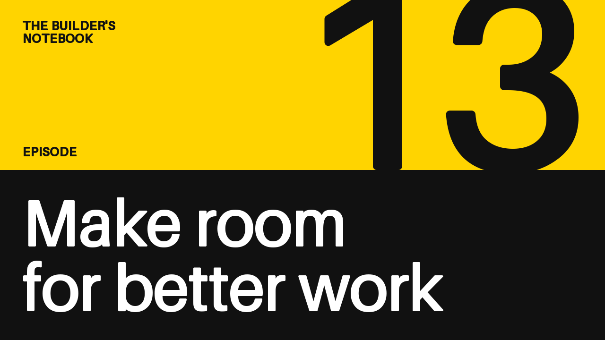
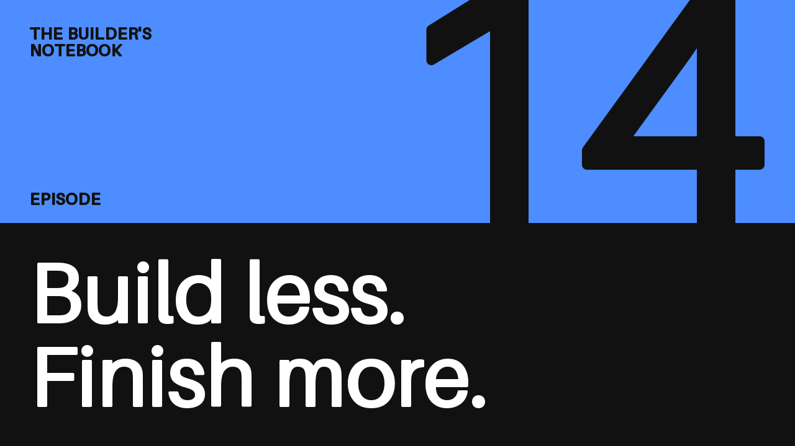

<section class="qt-hero" aria-labelledby="qt-heading" markdown>
<div class="qt-container qt-hero-layout" markdown>
<div class="qt-hero-copy" markdown>

<h1 id="qt-heading">Thumbnails,<br>from code.</h1>

<p class="qt-hero-description">Build a layout once. Update the content for your next post.</p>

<div class="qt-actions" markdown>
[Get started <span aria-hidden="true">→</span>](getting-started.md){ .qt-button .qt-button-white }
[Browse recipes](cookbook/index.md){ .qt-button .qt-button-outline }
</div>

<div class="qt-install">
<code>python -m pip install quickthumb</code>
<button type="button" class="qt-icon-button" data-qt-copy="python -m pip install quickthumb" aria-label="Copy install command"><svg viewBox="0 0 24 24" fill="none" stroke="currentColor" stroke-width="1.7" aria-hidden="true"><rect x="8" y="6" width="12" height="15" rx="2"/><path d="M16 3H6a2 2 0 0 0-2 2v12"/></svg></button>
<span class="qt-copy-status" role="status"></span>
</div>

</div>
<div class="qt-artwork" aria-label="Made with quickthumb" markdown>

[](cookbook/youtube-thumbnail.md#talking-head){ .qt-art .qt-art-back }
[](cookbook/youtube-thumbnail.md#reaction){ .qt-art .qt-art-front }
[](cookbook/podcast-promo.md){ .qt-art .qt-art-bottom }

</div>
</div>
</section>

<section class="qt-example qt-container" aria-labelledby="qt-example-heading" markdown>

<h2 id="qt-example-heading">One layout. Three episodes.</h2>

<p class="qt-section-description">Create a thumbnail once, update the content, and generate a full series.</p>

<div class="qt-example-layout" markdown>
<div class="qt-example-code" markdown>

<div class="qt-code-title"><span class="qt-code-dots" aria-hidden="true">● ● ●</span> episode_cards.py</div>

```python
episodes = [
    (12, "Ship your first release", "#FF4B1F"),
    (13, "Make room for better work", "#FFD400"),
    (14, "Build less. Finish more.", "#4D8DFF"),
]

for episode, title, accent in episodes:
    episode_card(episode, title, accent).render(
        f"episode-{episode}.png"
    )
```

[See the full Python example →](getting-started.md)

</div>
<div class="qt-episode-grid" markdown>
<figure markdown="span">

<figcaption>episode-12.png</figcaption>
</figure>
<figure markdown="span">

<figcaption>episode-13.png</figcaption>
</figure>
<figure markdown="span">

<figcaption>episode-14.png</figcaption>
</figure>
</div>
</div>

<p class="qt-example-note">Python 3.11+ · Base package only · No font or image downloads after installation</p>

</section>

<section class="qt-next qt-container" aria-label="Explore quickthumb" markdown>

<div markdown>

### Find your next layout

Thumbnails, social cards, and podcast covers, with the source for every design.

[Browse the cookbook →](cookbook/index.md)

</div>
<div markdown>

### Build with changing content

Fit longer titles, arrange layers, and load layouts from Python or JSON.

[Explore the API →](api/index.md)

</div>
<div markdown>

### Check and export

Check for common layout problems, then export images, slides, or video.

[See export options →](exports.md)

</div>

</section>
