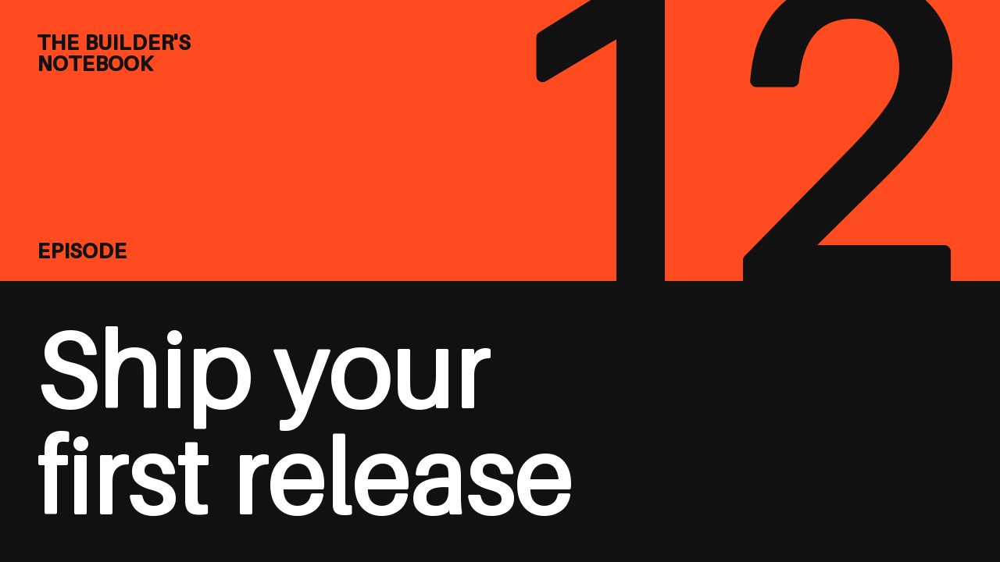
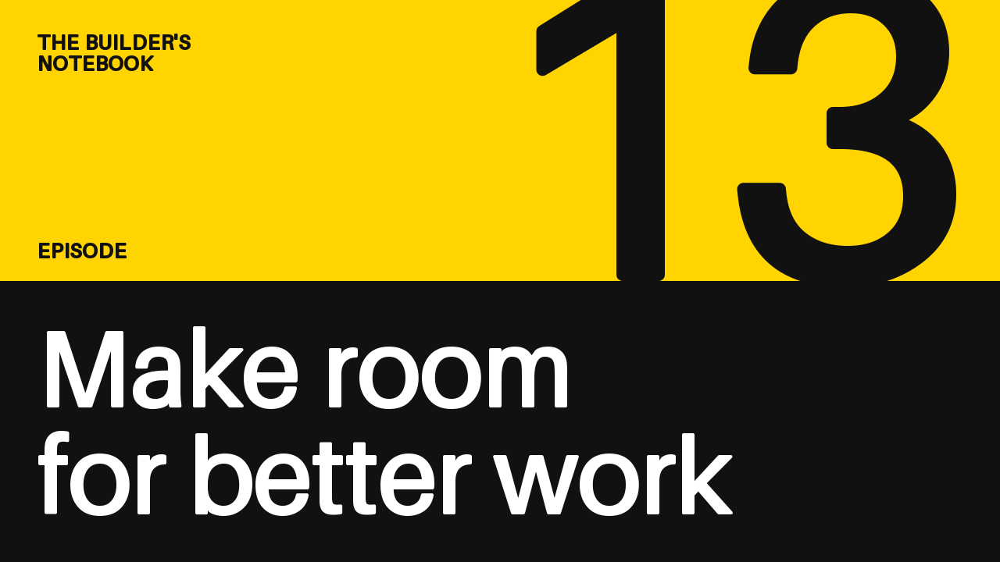
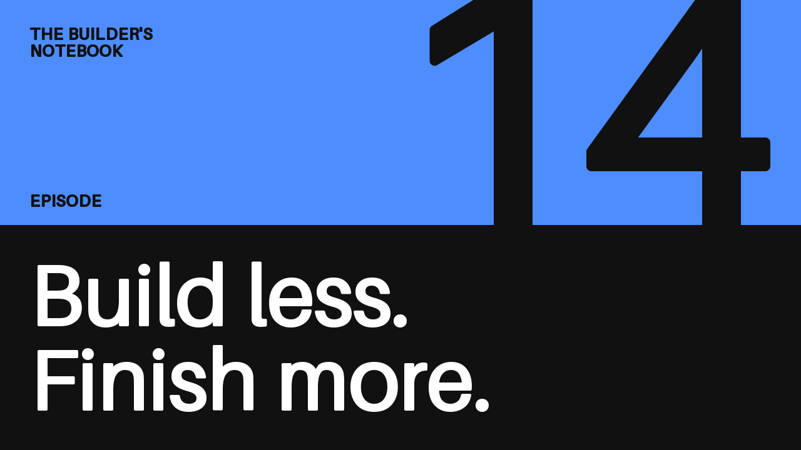

<section class="qt-hero" markdown>

# Thumbnails, from code

Create thumbnails and social images in Python or JSON. Build a layout once,
then update the text, images, and colors for your next post.

[Get started](getting-started.md){ .md-button .md-button--primary }
[Browse recipes](cookbook/index.md){ .md-button }

<figure class="qt-output" markdown="span">
[](cookbook/youtube-thumbnail.md#before-after)
<figcaption markdown="span">Made with quickthumb · [See the source](cookbook/youtube-thumbnail.md#before-after)</figcaption>
</figure>

</section>

<section class="qt-block" markdown>

## Start with a layout that fits your content

Each image links to a runnable recipe and its source.

<div class="qt-gallery" markdown>
[](cookbook/launch-announcement.md)
[](cookbook/youtube-thumbnail.md#reaction)
[](cookbook/podcast-promo.md)
[](cookbook/instagram-card.md)
</div>

[Browse all recipes →](cookbook/index.md){ .qt-more }

</section>

<section class="qt-block" markdown>

## Try a reusable layout

Start with a small example: one function, three episode cards.
For the designs above, open a recipe to use its fonts, images, and full layout.

<div class="qt-gallery qt-variants" markdown>



</div>

Python 3.11+ · Base package only · No font or image downloads after installation

```bash
python -m pip install quickthumb
```

Save as `episode_cards.py`, then run `python episode_cards.py`:

```python
--8<-- "examples/episode_cards.py"
```

Open `episode-12.png`, `episode-13.png`, and `episode-14.png` in the same directory.
Edit the `episodes` list and run it again to replace the cards with your own content.

Prefer JSON? [Load a spec from your pipeline or an AI workflow](json-schema.md).

</section>

<section class="qt-block" markdown>

## Keep the layout. Change the content

- **Fit changing titles.** Set text wrapping and fitting bounds, or use
  [auto-layout groups](api/group.md) to arrange rows and columns.
- **Catch common problems.** [Diagnostics](diagnostics.md) flag issues such as
  off-canvas layers, small text, and low contrast before export.
- **Use the output where you need it.** Export PNG, JPEG, WebP, SVG, HTML, or GIF
  with the base package. [Other formats](exports.md), including PDF, PPTX, and
  video, have additional dependencies and format-specific behavior.

For repeatable pixels, keep assets, fonts, and the rendering environment fixed.
[Read the reproducibility requirements](exports.md#render-reproducibility).

Need several slides or narrated video? Explore [Deck](api/deck.md).

</section>

<section class="qt-block qt-end" markdown>

## Make the next image your own

[Get started](getting-started.md){ .md-button .md-button--primary }
[API reference](api/index.md){ .md-button }

</section>
