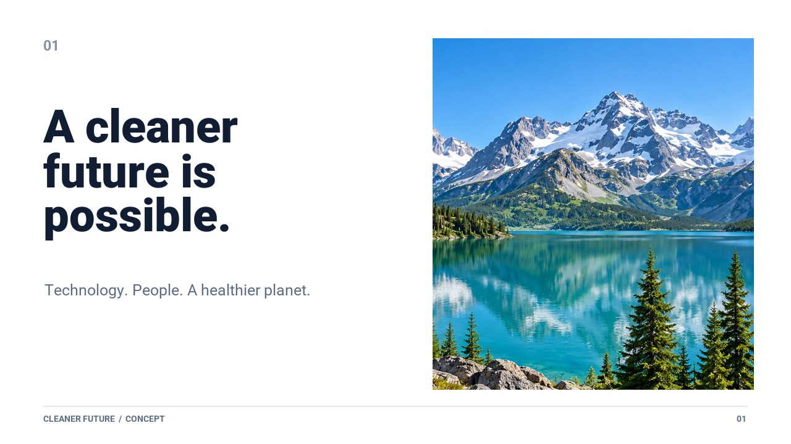
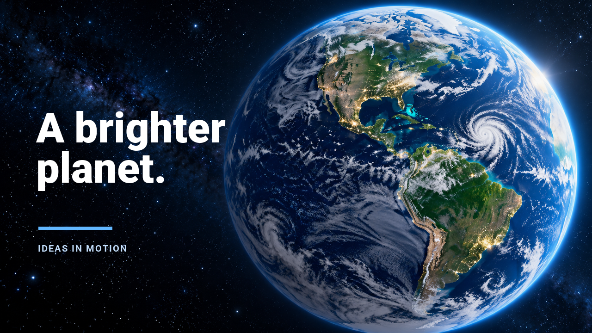
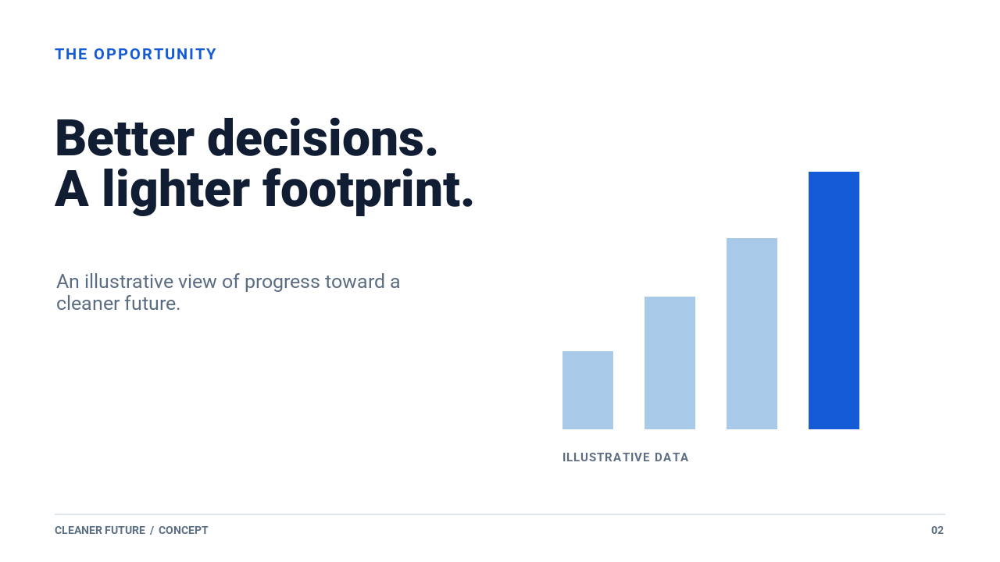
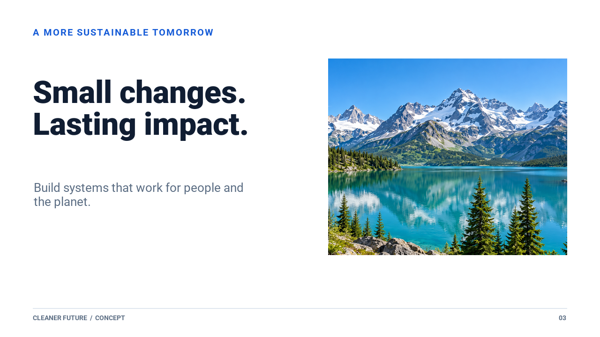

<section class="qt-hero" aria-labelledby="qt-heading" markdown>
<div class="qt-container qt-hero-layout" markdown>
<div class="qt-hero-copy" markdown>

<p class="qt-eyebrow">A Python creative toolkit</p>

<h1 id="qt-heading">Make visuals<br>with code.</h1>

<p class="qt-hero-description">Create images, presentations, and animated videos from reusable layouts.</p>

<div class="qt-actions" markdown>
[Get started <span aria-hidden="true">→</span>](#get-started){ .qt-button .qt-button-white }
[Explore examples](cookbook/index.md){ .qt-button .qt-button-outline }
</div>

</div>
<div class="qt-artwork" aria-label="Examples made with quickthumb" markdown>

[](cookbook/youtube-thumbnail.md#talking-head){ .qt-art .qt-art-back }
[](cookbook/decks-and-video.md#cleaner-future){ .qt-art .qt-art-front }
[](cookbook/decks-and-video.md#cleaner-future){ .qt-art .qt-art-bottom }
[](cookbook/decks-and-video.md#cleaner-future){ .qt-art .qt-art-video }

</div>
</div>
</section>

<section class="qt-story" aria-labelledby="images-heading" markdown>
<div class="qt-container qt-story-grid" markdown>
<div class="qt-story-copy" markdown>

<p class="qt-kicker">Images &amp; graphics</p>

## Compose images. { #images-heading }

Combine text, photos, and shapes into thumbnails, social graphics, and more. Your layout stays in code, ready to adapt.

[See the complete example →](cookbook/decks-and-video.md#cleaner-future){ .qt-story-link }

</div>
<div class="qt-visual qt-image-pair" markdown>


<div class="qt-code-window" markdown>
<div class="qt-code-title" markdown="span"><span class="qt-code-dots" aria-hidden="true"><i></i><i></i><i></i></span> cleaner_future.py</div>

```python
canvas = Canvas(1280, 720)
canvas.image("creator.png", (0, 0), 1280, 720,
             fit="cover")
canvas.text("PYTHON", position=(720, 110),
            font=HEAVY, size=118, color="#FFFFFF")
canvas.shape("rectangle", (710, 380), 515, 132,
             "#FFD400", rotation=-3)
canvas.text("CREATORS", position=(733, 399),
            font=HEAVY, size=88, color="#111923",
            rotation=-3)
```

</div>

</div>
</div>
</section>

<section class="qt-story qt-story-tinted" aria-labelledby="slides-heading" markdown>
<div class="qt-container qt-story-grid" markdown>
<div class="qt-story-copy" markdown>

<p class="qt-kicker">Presentations</p>

## Build presentations. { #slides-heading }

Bring canvases together in a deck with transitions and speaker notes. Export a presentation for the browser or PowerPoint.

[Explore the presentation →](cookbook/decks-and-video.md#cleaner-future){ .qt-story-link }

</div>
<div class="qt-visual qt-deck-preview" markdown>


<div class="qt-slide-strip" markdown>



</div>

</div>
</div>
</section>

<section class="qt-story" aria-labelledby="motion-heading" markdown>
<div class="qt-container qt-story-grid" markdown>
<div class="qt-story-copy" markdown>

<p class="qt-kicker">Video &amp; animation</p>

## Bring ideas to motion. { #motion-heading }

Animate layers and render a video or GIF. Add transitions, narration, and music as your story grows.

[Explore the video example →](cookbook/decks-and-video.md#cleaner-future){ .qt-story-link }

</div>
<div class="qt-visual qt-video-preview">
<video controls playsinline preload="none" poster="assets/home/brighter-planet-poster.png" aria-label="A brighter planet animation generated with quickthumb">
<source src="assets/home/brighter-planet.mp4" type="video/mp4">
Your browser does not support video. <a href="assets/home/brighter-planet.mp4">Download the animation</a>.
</video>
</div>
</div>
</section>

<section class="qt-story qt-story-tinted" aria-labelledby="reuse-heading" markdown>
<div class="qt-container qt-story-grid" markdown>
<div class="qt-story-copy" markdown>

<p class="qt-kicker">Reusable by design</p>

## Create once. Reuse everywhere. { #reuse-heading }

Keep your design in Python or JSON. Change the content and generate a new series without rebuilding each visual by hand.

[See the complete example →](getting-started.md){ .qt-story-link }

</div>
<div class="qt-visual qt-reuse" markdown>
<div class="qt-code-window" markdown>
<div class="qt-code-title" markdown="span"><span class="qt-code-dots" aria-hidden="true"><i></i><i></i><i></i></span> episode_cards.py</div>

```python
episodes = [
    (12, "Ship your first release", "#FF4B1F"),
    (13, "Make room for better work", "#FFD400"),
    (14, "Build less. Finish more.", "#4D8DFF"),
]
for episode, title, accent in episodes:
    episode_card(episode, title, accent).render(
        f"episode-{episode}.png"
    )
```

</div>
<div class="qt-reuse-results" markdown>


</div>
</div>
</div>
</section>

<section class="qt-story" id="get-started" aria-labelledby="start-heading" markdown>
<div class="qt-container qt-story-grid" markdown>
<div class="qt-story-copy" markdown>

<p class="qt-kicker">Get started</p>

## A few lines of code. { #start-heading }

Install quickthumb, then create your first image with the built-in font. Python 3.11 or later required.

[Continue with the guide →](getting-started.md){ .qt-story-link }

</div>
<div class="qt-visual" markdown>

```bash
python -m pip install quickthumb
```

```python
from quickthumb import Canvas

canvas = Canvas(1280, 720).background(color="#155BD7")
canvas = canvas.text("Hello, quickthumb", size=96,
                     color="#FFFFFF", position=(64, 280))
canvas.render("hello.png")
```

</div>
</div>
</section>
