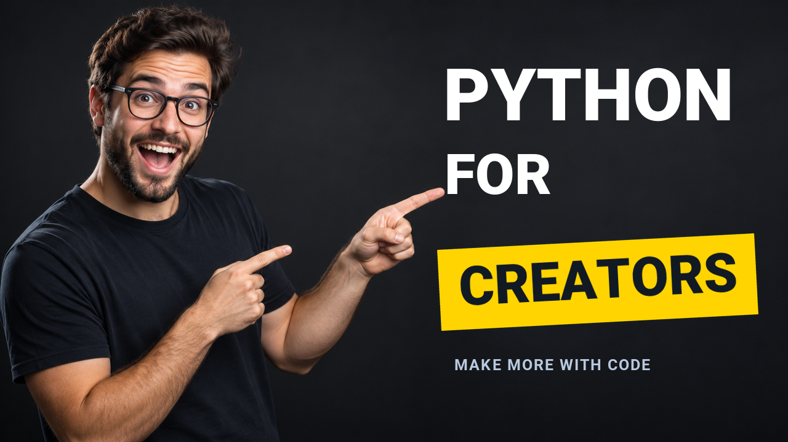
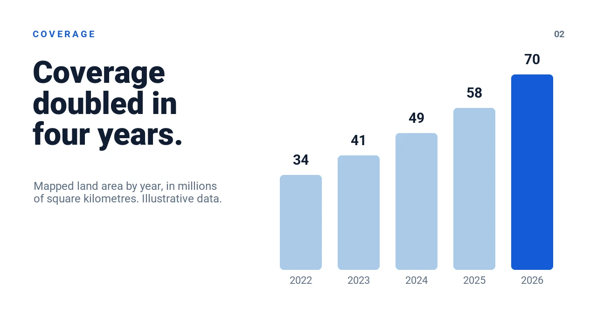
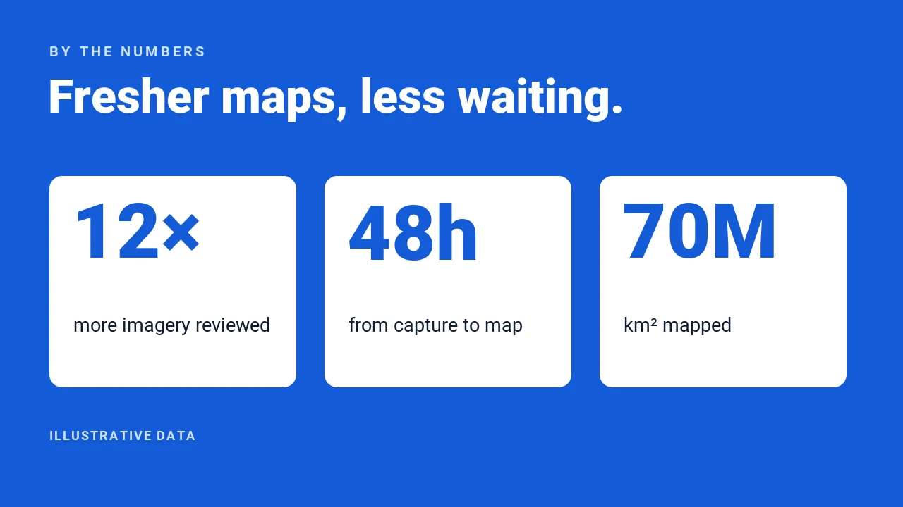
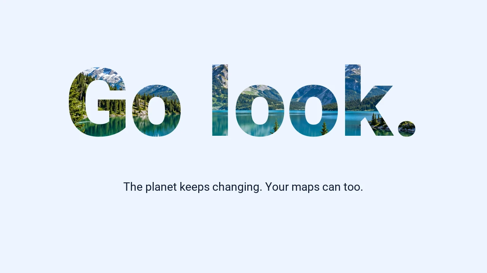
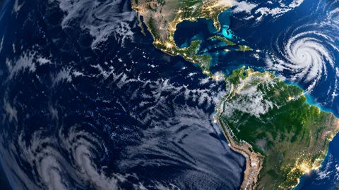
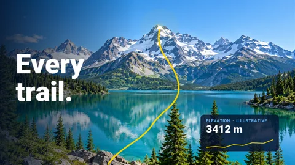
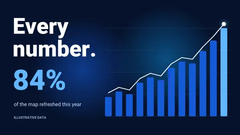

<section class="qt-hero" aria-labelledby="qt-heading" markdown>
<div class="qt-container qt-hero-layout" markdown>
<div class="qt-hero-copy" markdown>

<p class="qt-eyebrow">用 Python 制作图像与视频</p>

<h1 id="qt-heading">写好的版式，<br>下次接着用。</h1>

<p class="qt-hero-description">用 Python 制作图像、演示文稿和视频。把版式保存在代码里，只需替换照片和标题，就能直接复用。</p>

<div class="qt-actions" markdown>
[查看实际示例 <span aria-hidden="true">→</span>](cookbook/index.md){ .qt-button .qt-button-white }
[安装与开始使用](installation.md){ .qt-button .qt-button-outline }
</div>

<ul class="qt-traits">
<li><svg viewBox="0 0 24 24" aria-hidden="true"><path d="M19.14 7.5A2.86 2.86 0 0 1 22 10.36v3.78A2.86 2.86 0 0 1 19.14 17H12c0 .39.32.96.71.96H17v1.68a2.86 2.86 0 0 1-2.86 2.86H9.86A2.86 2.86 0 0 1 7 19.64v-3.75a2.85 2.85 0 0 1 2.86-2.85h5.25a2.85 2.85 0 0 0 2.85-2.86V7.5zm-4.28 11.79c-.4 0-.72.3-.72.89s.32.71.72.71a.71.71 0 0 0 .71-.71c0-.59-.32-.89-.71-.89m-10-1.79A2.86 2.86 0 0 1 2 14.64v-3.78A2.86 2.86 0 0 1 4.86 8H12c0-.39-.32-.96-.71-.96H7V5.36A2.86 2.86 0 0 1 9.86 2.5h4.28A2.86 2.86 0 0 1 17 5.36v3.75a2.85 2.85 0 0 1-2.86 2.85H8.89a2.85 2.85 0 0 0-2.85 2.86v2.68zM9.14 5.71c.4 0 .72-.3.72-.89s-.32-.71-.72-.71c-.39 0-.71.12-.71.71s.32.89.71.89"/></svg>Python 3.11+</li>
<li><svg viewBox="0 0 24 24" aria-hidden="true"><path d="M15.41 22h-.19a.46.46 0 0 1-.26-.27l-2.22-5.8c-.09-.24.03-.51.26-.61.71-.26 1.28-.82 1.58-1.49.64-1.43 0-3.1-1.43-3.74s-3.1 0-3.74 1.41c-.3.71-.32 1.5-.05 2.19.3.74.89 1.31 1.64 1.59.24.09.37.36.28.61L9 21.69c-.04.12-.13.22-.25.27-.12.04-.25.04-.36 0C3.24 19.97.67 14.18 2.66 9.03s7.78-7.72 12.93-5.73c2.47.96 4.46 2.85 5.54 5.27a9.9 9.9 0 0 1 .2 7.65c-1.01 2.66-3.1 4.78-5.75 5.78zM12 3.59c-4.97-.13-9.1 3.8-9.23 8.77a9.01 9.01 0 0 0 5.55 8.54l1.89-4.9c-1.83-1-2.52-3.28-1.53-5.11a3.784 3.784 0 0 1 5.11-1.53 3.775 3.775 0 0 1 0 6.64l1.89 4.93a9.11 9.11 0 0 0 4.76-5c1.84-4.62-.4-9.85-5.02-11.7A9.1 9.1 0 0 0 12 3.59"/></svg>开源</li>
<li><svg viewBox="0 0 24 24" aria-hidden="true"><path d="M5 3h2v2H5v5a2 2 0 0 1-2 2 2 2 0 0 1 2 2v5h2v2H5c-1.07-.27-2-.9-2-2v-4a2 2 0 0 0-2-2H0v-2h1a2 2 0 0 0 2-2V5a2 2 0 0 1 2-2m14 0a2 2 0 0 1 2 2v4a2 2 0 0 0 2 2h1v2h-1a2 2 0 0 0-2 2v4a2 2 0 0 1-2 2h-2v-2h2v-5a2 2 0 0 1 2-2 2 2 0 0 1-2-2V5h-2V3zm-7 12a1 1 0 0 1 1 1 1 1 0 0 1-1 1 1 1 0 0 1-1-1 1 1 0 0 1 1-1m-4 0a1 1 0 0 1 1 1 1 1 0 0 1-1 1 1 1 0 0 1-1-1 1 1 0 0 1 1-1m8 0a1 1 0 0 1 1 1 1 1 0 0 1-1 1 1 1 0 0 1-1-1 1 1 0 0 1 1-1"/></svg>代码或 JSON</li>
</ul>

</div>
<div class="qt-artwork" role="group" aria-label="quickthumb 制作的示例" markdown>

[](cookbook/decks-and-video.md#cleaner-future){ .qt-art .qt-art-front }
[](cookbook/podcast-promo.md){ .qt-art .qt-art-back }
[](cookbook/decks-and-video.md#orbit-atlas){ .qt-art .qt-art-bottom }

</div>
</div>
</section>

<section class="qt-story" aria-labelledby="images-heading" markdown>
<div class="qt-container qt-story-grid" markdown>
<div class="qt-story-copy" markdown>

<p class="qt-kicker">图像与图形</p>

## 下一张缩略图，换掉照片和标题就行。 { #images-heading }

把文字、照片和形状的排版写成代码。需要制作同一系列的新缩略图或社交媒体配图时，只需替换照片和文字内容。

[查看缩略图示例 <span aria-hidden="true">→</span>](cookbook/decks-and-video.md#orbit-atlas){ .qt-button .qt-button-blue }

</div>
<div class="qt-visual qt-image-pair" markdown>


```python
# Simplified from examples/orbit_atlas.py
canvas = Canvas(WIDTH, HEIGHT).image(
    CREATOR, (0, 0), WIDTH, HEIGHT, fit="cover"
)
canvas.text(
    "I MAPPED\nTHE PLANET", position=(716, 58),
    font=HEAVY, size=86, color=WHITE,
)
canvas.shape("rectangle", (722, 252), 486, 104,
             YELLOW, rotation=-3)
canvas.text(
    "WITH PYTHON", position=(756, 270),
    font=HEAVY, size=62, color="#111923",
    rotation=-3,
)
```

</div>
</div>
</section>

<section class="qt-story qt-story-tinted" aria-labelledby="slides-heading" markdown>
<div class="qt-container qt-story-grid" markdown>
<div class="qt-story-copy" markdown>

<p class="qt-kicker">演示文稿</p>

## 幻灯片也可以用 Python 制作。 { #slides-heading }

在同一份代码中编排封面和每一页幻灯片，轻松组织成完整的演示文稿。做好的幻灯片可以在浏览器中直接查看，也能导出为 PowerPoint 文件。

[查看幻灯片示例 <span aria-hidden="true">→</span>](cookbook/decks-and-video.md#orbit-atlas){ .qt-button .qt-button-blue }

</div>
<div class="qt-visual qt-deck-preview" markdown>


<div class="qt-slide-strip" markdown>








</div>

</div>
</div>
</section>

<section class="qt-story" aria-labelledby="motion-heading" markdown>
<div class="qt-container qt-story-grid" markdown>
<div class="qt-story-copy" markdown>

<p class="qt-kicker">视频与动画</p>

## 文字渐入，照片动起来。 { #motion-heading }

为文字和照片添加动效，设定转场与时间轴，渲染出视频或 GIF。搭配背景音乐后的效果，可以在下方的 Orbit Atlas 视频中直接播放体验。

[查看视频示例 <span aria-hidden="true">→</span>](cookbook/decks-and-video.md#orbit-atlas){ .qt-button .qt-button-blue }

</div>
<div class="qt-visual qt-video-preview">
<div class="qt-video-player">
<video controls playsinline preload="none" poster="/assets/home/orbit-film-poster.webp" aria-label="用 quickthumb 生成的 Orbit Atlas 动画">
<source src="/assets/home/orbit-film.mp4" type="video/mp4">
您的浏览器不支持视频播放。<a href="/assets/home/orbit-film.mp4">下载动画视频</a>。
</video>
<button class="qt-play" type="button" data-qt-play aria-label="播放 Orbit Atlas 视频"><svg viewBox="0 0 24 24" aria-hidden="true"><path d="M8 5.14v14l11-7z"/></svg></button>
</div>
<div class="qt-video-frames">



</div>
</div>
</div>
</section>

<section class="qt-story qt-story-tinted" aria-labelledby="reuse-heading" markdown>
<div class="qt-container qt-story-grid" markdown>
<div class="qt-story-copy" markdown>

<p class="qt-kicker">用代码沉淀版式</p>

## 下一个项目，直接从现有代码起步。 { #reuse-heading }

把版式保存在 Python 或 JSON 中，后续项目可以随时按需微调。下面的示例展示了如何用同一段脚本分别生成缩略图、演示文稿和视频。

</div>
<div class="qt-visual qt-reuse" markdown>

```python
# Simplified from examples/orbit_atlas.py
planet_thumbnail().render(
    str(out / "orbit-thumbnail-planet.webp"),
    quality=88,
)

slides = deck()
slides.render(str(out / "orbit-deck.html"))
if args.pptx:
    slides.render(str(out / "orbit-deck.pptx"))

if not args.stills:
    render_film(out)  # orbit-film.mp4
```

<ul class="qt-outputs">
<li><span><strong>缩略图</strong>WebP</span></li>
<li><span><strong>演示文稿</strong>HTML, PPTX</span></li>
<li><span><strong>视频</strong>MP4</span></li>
</ul>

</div>
</div>
</section>

<section class="qt-story" id="install" aria-labelledby="install-heading" markdown>
<div class="qt-container qt-story-grid" markdown>
<div class="qt-story-copy" markdown>

<p class="qt-kicker">开始使用</p>

## 改改示例代码，做出你的第一张卡片。 { #install-heading }

需要 Python 3.11 或更高版本。安装完成后，你可以直接修改示例代码中的文字和配色，快速制作自己的卡片。

详细安装方式请参考[安装指南](installation.md)。

[制作第一张卡片 <span aria-hidden="true">→</span>](getting-started.md){ .qt-button .qt-button-dark }

</div>
<div class="qt-visual" markdown>

```bash
python -m pip install quickthumb
```

</div>
</div>
</section>
